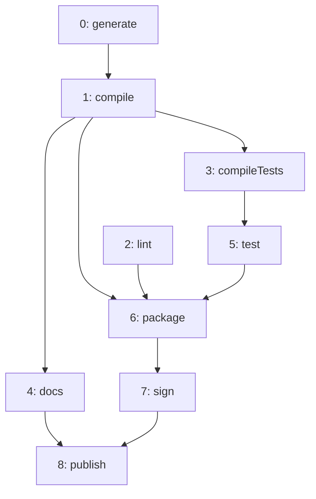

import Example from '../../../components/Example.astro';
import Api from '../../../components/Api.astro';
import Compare from '../../../components/Compare.astro';
import Gap from '../../../components/Gap.astro';
import InCode from '../../../components/InCode.astro';

:::note[In short]
- <Api ref="Graphs.adjacencyListOf(Graph)" /> returns the whole graph as text: one line per node
  with its [out-nodes](../../glossary/#out-node-and-in-node).
- <Api ref="Graph.toString()" /> gives a summary in one line. For a large graph, it is cut after the
  first nodes.
:::

## Problem

You want to see a graph quickly, as text. A picture is too much, and a line per node is enough. For
a large graph, you want a summary that stays short. You need this for:

- the expected value of a test;
- a log of the graph a program built;
- an error message that shows the graph it is about.

## Example

The example graph `steps` models the nine steps that build and publish a small program. It has an
edge `a -> b` if step `b` may start only after step `a`:

A test of the build should check that the graph has exactly these edges, and the log of the build
should show it in one line.

## Solution

<Example java="guide/ShowingGraphs.java#text" />

The [adjacency list](../../glossary/#adjacency-list) has a line for every node, with its out-nodes
in ascending order. It is the same for equal graphs, so tests can compare it with an expected text,
as the tests of the examples in this guide do. The summary starts with the node and edge counts and
lists at most 16 nodes and 64 out-nodes, so that it stays short however large the graph is. `...`
marks where it is cut. The steps are few enough for the summary to show them all.

## Good to know

- **Names.** Both forms show [node IDs](../../glossary/#node-id). For names, write the lines
  yourself, one per edge, with <Api ref="Graph.forEachEdge(EdgeConsumer)" /> and your array of
  names. See [Keep data on nodes and edges](../../basics/keep-data/). You can also draw the graph
  with its names. See [Draw a graph as a Mermaid flowchart](../mermaid/).

<Gap>
Print a graph as an adjacency list with the names of its nodes:
<Api ref="Graphs.adjacencyListOf(Graph)" /> takes no labels, unlike the writers, so a list with
names is written by hand.
</Gap>
