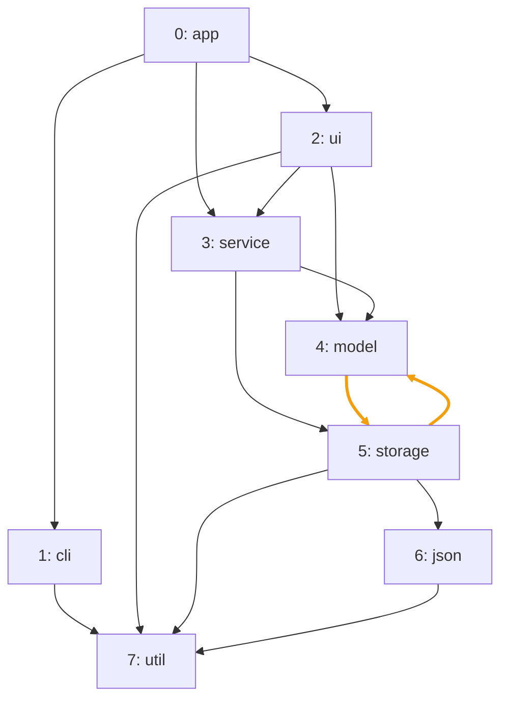
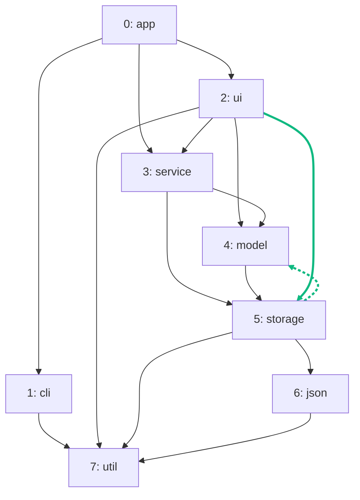

import Example from '../../../components/Example.astro';
import Api from '../../../components/Api.astro';
import Compare from '../../../components/Compare.astro';
import Gap from '../../../components/Gap.astro';
import InCode from '../../../components/InCode.astro';

:::note[In short]
- <Api ref="Graphs.diff(Graph, Graph)" /> compares two graphs over the same nodes. The older graph
  is the first argument.
- <Api ref="GraphDiff.addedEdges()" /> returns the edges that only the newer graph has, each with
  its [edge index](../../glossary/#edge-index) in the newer graph.
- <Api ref="GraphDiff.removedEdges()" /> returns the edges that only the older graph has, each with
  its edge index in the older graph.
:::

## Problem

What changed between two versions of a graph? You want the edges that were added and the edges that
were removed. You need this for:

- a review of the dependencies that a change adds or removes;
- a monitor that reports the network links between servers that appeared or disappeared since
  yesterday;
- an incremental analysis that updates its results instead of starting over.

## Example

The example graph `dependencies` models the dependencies between the eight packages of a small
program. It has an edge from each package to each package it uses. In version 1, `model` and
`storage` use each other. The edges between them lie on a [cycle](../../glossary/#cycle), which the
picture before shows in orange. In version 2, `storage` no longer uses `model`, which breaks the
cycle. But `ui` now uses `storage`. The graph
<InCode java="nextVersion" rust="next_version" ts="nextVersion" csharp="nextVersion" /> holds
version 2. Which edges were added, and which were removed? The picture after shows version 2. The
added edge `ui -> storage` is in solid green. The removed edge `storage -> model` is in dashed
green, because version 2 no longer has it.

<Compare
  before="The packages, version 1"
  after="Version 2, with ui -> storage added and storage -> model removed"
  legend={{ outputEdge: 'Added edge', removedEdge: 'Removed edge' }}
>

</Compare>

## Solution

<Example java="guide/StoringAndComparing.java#diff" />

The diff has one added edge and one removed edge. The added edge is `ui -> storage`, with the edge
index 6 in version 2
(<InCode java="nextVersion" rust="next_version" ts="nextVersion" csharp="nextVersion" />). The
removed edge is `storage -> model`, with the edge index 10 in version 1 (`dependencies`). With these
edge indices, you can look up your data on the edges of either version.

An <Api ref="Edges" /> lists its edges position by position: the
[source](../../glossary/#source-and-target) in <Api ref="Edges.sourceNodes()" />, the target in
<Api ref="Edges.targetNodes()" /> and the edge index in <Api ref="Edges.edgeIndices()" />.
See [Work with the lists Graphity returns](../../basics/result-lists/).

## Good to know

- **The same nodes.** Both graphs must have the same nodes: the same node count, and the same
  [node ID](../../glossary/#node-id) for the same package in both.
  <Api ref="Graphs.diff(Graph, Graph)" /> rejects two graphs with different node counts
  (<InCode java="IllegalArgumentException" rust="panic" ts="Error" csharp="ArgumentException" />).
- **Versions with different nodes.** Number the nodes over both versions together, so that a node
  keeps its node ID. For example, give one node ID to each package name that occurs in either
  version. A map from names to node IDs does that.
  See [Build a graph from objects of your own](../../basics/build-from-objects/) for such a map. A
  node that one version lacks has no edges there. The diff then also lists the edges of the nodes
  that were added or removed. A node without edges does not appear in the diff, so compare the lists
  of names as well.
- **Equal or not.** <Api ref="GraphDiff.isEmpty()" /> answers this: an empty diff means equal
  graphs.
- **In edge index order.** Both lists are in edge index order, that is, by source and then by
  target. So the changed [outgoing edges](../../glossary/#outgoing-and-incoming-edge) of one package
  stand together.
- **Only whether it changed?** A hash answers that without the old graph at hand. See
  [Find out cheaply whether a graph has changed](../hash/).
