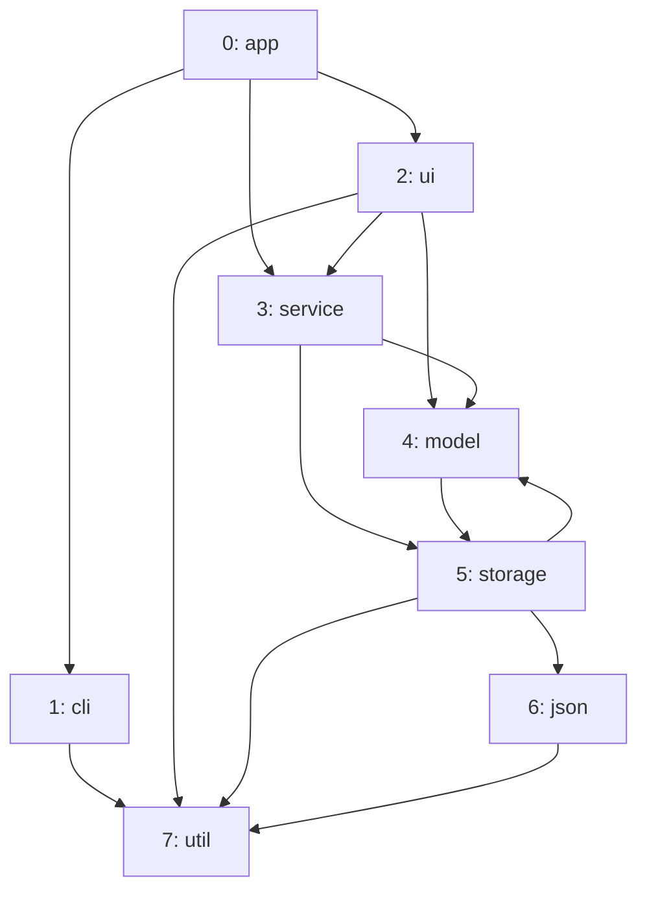
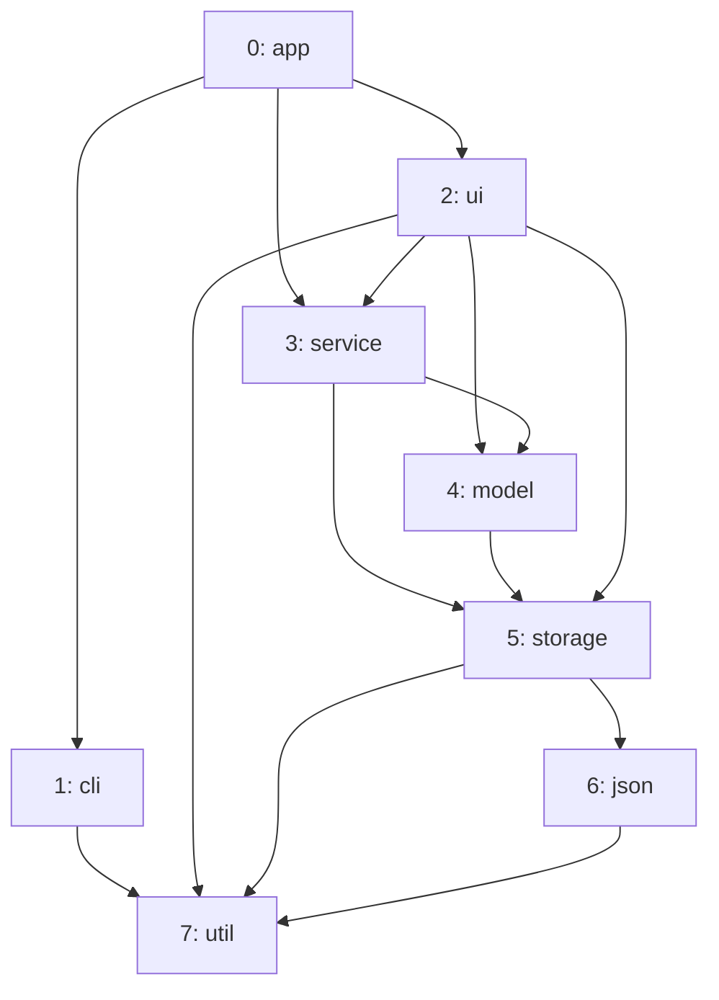

import Example from '../../../components/Example.astro';
import Api from '../../../components/Api.astro';
import Compare from '../../../components/Compare.astro';
import Gap from '../../../components/Gap.astro';
import InCode from '../../../components/InCode.astro';

:::note[In short]
- <Api ref="Graphs.topologyHash(Graph)" /> returns a 64-bit hash of the nodes and edges of a graph.
  The hash is the same in every run.
- Equal graphs have equal hashes; different graphs rarely do.
:::

## Problem

Has the graph changed since last time? Comparing it with an old copy means keeping the copy. A hash
of 64 bits is enough to tell, and the chance of an error is very small. You need this for:

- a build tool that skips an analysis when the dependency graph is the same as in the last run;
- a cache that needs a key for the results computed on a graph;
- an iteration that stops when a transformation no longer changes the graph.

## Example

The example graph `dependencies` models the dependencies between the eight packages of a small
program. It has an edge from each package to each package it uses. The code builds the same graph a
second time from a list of pairs of [node IDs](../../glossary/#node-id). The pairs come in another
order, and one of them is given twice. See [Build a graph from a list of
edges](../../basics/build-from-edges/) for this way of building a graph. The picture after shows a
later version of the program, which changes two dependencies. `storage` no longer uses `model`, so
the edge `storage -> model` is gone. The edge `ui -> storage` is new. The graph
<InCode java="nextVersion" rust="next_version" ts="nextVersion" csharp="nextVersion" /> holds this
later version. Do the hashes show which two graphs are equal and which one has changed?

<Compare before="Version 1, built twice" after="Version 2">

</Compare>

## Solution

<Example java="guide/StoringAndComparing.java#topologyHash" />

The graph built a second time (`rebuilt`) has the same hash as `dependencies`. It has the same nodes
and edges, although its pairs came in another order and one of them came twice. The later version
(<InCode java="nextVersion" rust="next_version" ts="nextVersion" csharp="nextVersion" />) has
another hash.

## Good to know

- **The same in every run.** The hash depends on nothing but the nodes and edges, so it can be
  stored and compared across runs and machines. A release of Graphity that changes it says so in
  its changelog. <Api ref="Graph.hashCode()" /> makes no such promise.
- **The same numbering.** The hash covers the node IDs and edges, not your names for the nodes. The
  same packages numbered in another order give another hash. Other packages numbered alike can give
  the same hash. Number the nodes the same way in every run, for example in the order of their
  sorted names. Where the names can change, keep them in the key next to the hash.
- **Computed on every call.** Compute the hash once and keep it, for example as the key of a cache.
- **Not a proof.** Equal hashes make equal graphs very likely, but do not prove them. Different
  graphs can also be made to have equal hashes on purpose. Where it matters, compare with
  <Api ref="Graph.equals(Object)" />.
  See [Find the edges added and removed between two versions](../diff/) for how to find the
  differences.
