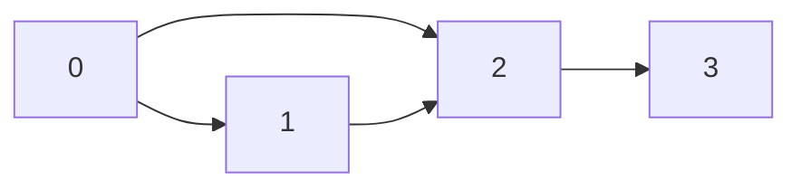

import ChapterProblems from '../../../components/ChapterProblems.astro';

A graph that took long to build is worth keeping, for example one built from a large codebase or a
database. A graph that changes over time raises the question of what changed.

## Problems in this chapter

<ChapterProblems />

The examples of this chapter use a small program: the dependencies between its packages, and a later
version of them.

## What a graph is made of

A graph is its nodes and edges and nothing else. That means the node count and, for each node, its
[out-nodes](../glossary/#out-node-and-in-node). Graphity keeps them in two arrays, called the
[CSR layout](../glossary/#csr-layout) (compressed sparse row) of the graph. One array holds the
out-nodes of all nodes, node after node. The other holds the position in that array where the
out-nodes of each node start. A file holds the same:

| what | the values for this graph |
|---|---|
| node count, edge count | 4, 4 |
| where the out-nodes of each node start, and the edge count | 0, 2, 3, 4, 4 |
| the out-nodes of all nodes | 1, 2, 2, 3 |

So a graph read back is equal to the graph written. Two graphs are equal if they have the same node
count and the same edges, however they were built. The edges may have come in another order, and an
edge may have been given twice.

Your data on nodes and edges is not part of the graph. You keep it in arrays of your own, indexed by
[node ID](../glossary/#node-id) and [edge index](../glossary/#edge-index). You store it next to the
graph, the way you store any other data. It stays valid, because the node IDs and edge indices of
the graph read back are those of the graph written.

## Versions

Two versions of a graph can be compared only if a node means the same in both: the same node ID for
the same package, method or server. A hash tells cheaply whether a graph has changed at all. A diff
lists the edges that were added and removed.
