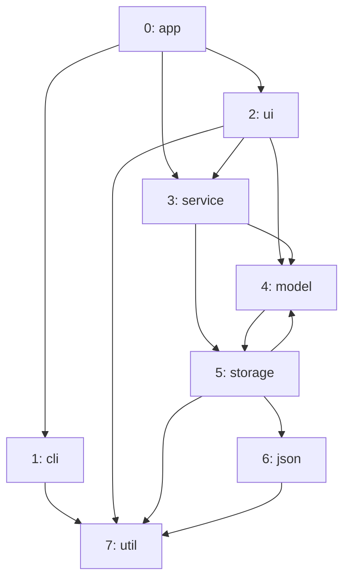

import Example from '../../../components/Example.astro';
import Api from '../../../components/Api.astro';
import Compare from '../../../components/Compare.astro';
import Gap from '../../../components/Gap.astro';
import InCode from '../../../components/InCode.astro';
import PerLanguage from '../../../components/PerLanguage.astro';

:::note[In short]
- <Api ref="Graph.writeTo(OutputStream)" /> writes a graph in a compact binary form.
- <Api ref="Graph.readFrom(InputStream)" /> reads it back as a graph equal to the one written. The
  [node IDs](../../glossary/#node-id) and [edge indices](../../glossary/#edge-index) stay the same.
:::

## Problem

You want to build a graph once, keep the result and load it again quickly. Building it can take
long, for example when it means parsing a codebase, querying a database or crawling a network. You
need this for:

- a cache of a graph that is expensive to build, such as the calls of a large codebase;
- a graph that one process hands to another, in a file or a message;
- a snapshot of a graph, to compare with a later version.

## Example

The example graph `dependencies` models the dependencies between the eight packages of a small
program. It has an edge from each package to each package it uses. That makes 8 nodes and 14 edges.
The code writes the graph to a file and reads it back. Is the graph read back the same, and how
large is the file?

## Solution

<Example java="guide/StoringAndComparing.java#writeRead" />

The graph read back is equal to the one written. The file holds the node count and the edge count,
then the two arrays of the [CSR layout](../../glossary/#csr-layout) (compressed sparse row) of the
graph. That makes 100 bytes in all:

- 8 bytes for the two counts;
- 4 bytes for each of the 9 entries of the array of start positions (one per node and one more);
- 4 bytes for each of the 14 edges.

Reading checks the arrays as <Api ref="Graph.of(int[], int[])" /> does.

## Good to know

- **The same on every machine.** The numbers are always written in little-endian byte order, so a
  file written on one machine reads on any other.
- **Nothing but the graph.** Graphity writes no marker, version or checksum. Reading rejects only
  data that does not form a graph. A damaged file whose numbers still form a graph reads as a graph.
  Where the data may come from elsewhere or be damaged, write a marker or a checksum of your own
  next to the graph.
- **Bi-adjacent graphs.** A <Api ref="BiAdjacentGraph" /> is written without its
  [in-nodes](../../glossary/#out-node-and-in-node). Reading always returns a plain
  <Api ref="Graph" />. <Api ref="BiAdjacentGraph.of(Graph)" /> builds the in-nodes again where you
  need them.

<PerLanguage>

- **Not only files.** Any output and input works, such as a file, a socket or a buffer in memory.
  Other data can come before or after the graph, such as your arrays of names. Reading takes only
  the bytes of the graph. Neither call closes a stream you go on using.

- **Not only files.** Any output and input works, such as a file, a socket or a buffer in memory.
  Other data can come before or after the graph, such as your arrays of names. Reading takes only
  the bytes of the graph. Neither call closes a stream you go on using.

- **Not only files.** <Api ref="Graph.writeTo(OutputStream)" /> writes to anything with a `write`
  method that takes bytes, such as a file stream, a socket or an object that collects the chunks in
  memory. It closes nothing. <Api ref="Graph.readFrom(InputStream)" /> takes no stream but the bytes
  themselves, such as the content of a file or of a message. Other data can come before or after
  the graph, such as your arrays of names. Use `subarray` to pass the bytes from where the graph
  starts. The data after the graph starts 8 + 4 x (node count + 1 + edge count) bytes later, and
  reading leaves it alone. The graph may keep a view of these bytes instead of a copy, so do not
  change them afterwards. To keep only the graph in memory, read from a copy that holds only the
  bytes of the graph.

- **Not only files.** Any output and input works, such as a file, a socket or a buffer in memory.
  Other data can come before or after the graph, such as your arrays of names. Reading takes only
  the bytes of the graph. Neither call closes a stream you go on using.

</PerLanguage>

<Gap>
Read and write other formats, such as edge lists in text or CSV files (comma-separated values) or
GraphML. Graphity reads only its own binary form. It can also write a graph as text, but nothing
reads that text back. See [Print a graph as text](../../showing/text/),
[Draw a graph with Graphviz](../../showing/graphviz/) and
[Draw a graph as a Mermaid flowchart](../../showing/mermaid/).
</Gap>
