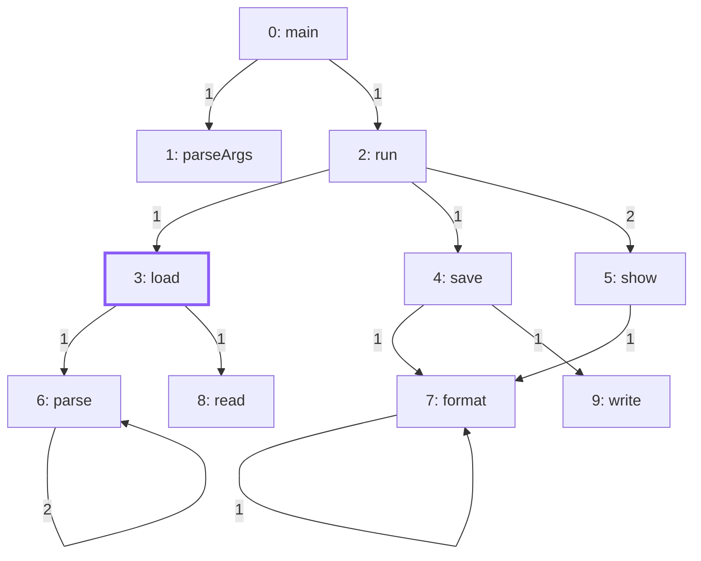
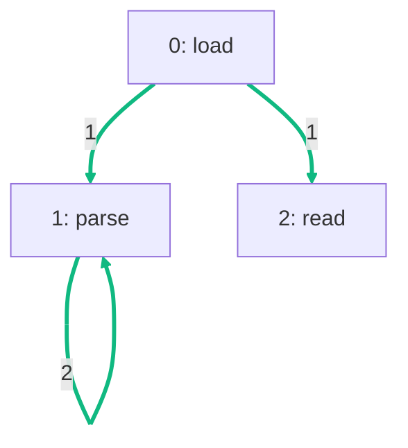

import Example from '../../../components/Example.astro';
import Api from '../../../components/Api.astro';
import Compare from '../../../components/Compare.astro';
import Gap from '../../../components/Gap.astro';
import InCode from '../../../components/InCode.astro';

:::note[In short]
- <Api ref="Graphs.edgeMapping(Graph, Graph, NodeMapping)" /> returns, for each edge of a
  transformed graph, the edge of the original graph it comes from.
- <Api ref="EdgeMapping.gather(int[])" /> carries an array of edge data over to the new [edge
  indices](../../glossary/#edge-index).
:::

## Problem

You derived a new graph from an old one and want your data on the edges, such as weights, counts or
labels, to come along. This data is kept in arrays by edge index. The new graph numbers its edges
anew, just like its nodes. A [mapping](../../glossary/#mapping) of the [node
IDs](../../glossary/#node-id) tells which new node is which old one, but not which new edge is which
old one. You need a mapping of the edges. This comes up:

- after you take a [subgraph](../../glossary/#subgraph), when an analysis of it needs the weights or
  labels of its edges;
- after a renumbering, which changes the edge indices along with the node IDs;
- after edges were added or left out by building the graph again, which shifts the edge indices;
- when you translate results on the new graph, such as the edges a search followed, back to the
  original edges.

## Example

The example graph `calls` models the calls between the ten methods of a small program. It has an
edge from each method to each method it calls. A place in the code where one method calls another is
called a call site. The array
<InCode java="siteCount" rust="site_count" ts="siteCount" csharp="siteCount" /> holds the number of
call sites of each call: `run` calls `show` from two places, and `parse` calls itself from two. The
graph `loading` is the subgraph of the methods that `load` [reaches](../../glossary/#reach). It
numbers nodes and edges anew. The mapping
<InCode java="newToOld" rust="new_to_old" ts="newToOld" csharp="newToOld" /> gives the old node ID
of each of its nodes.
See [Take the subgraph of some nodes](../subgraph/) for how to build both. How many call sites does
each call of the subgraph have? The picture after shows the subgraph with the call sites on its
edges:

<Compare
  before="The calls with their call sites"
  after="The subgraph of the methods load reaches, with its call sites"
  legend={{ contextNode: 'Start node', outputEdge: 'Call with its call sites' }}
>

</Compare>

## Solution

<Example java="guide/TransformingGraphs.java#edgeData" />

The edge mapping leads from each edge of `loading` to the edge of `calls` it comes from.
<Api ref="EdgeMapping.gather(int[])" label="gather" /> carries the call sites over through it. The
result holds 1, 1 and 2 for `load -> parse`, `load -> read` and `parse -> parse`, in the order of
their new edge indices, as in the picture after.

## Good to know

- **Any kind of data.** <InCode java="long[]" rust="Vec<i64>" ts="BigInt64Array" csharp="long[]" /> and
  <InCode java="double[]" rust="Vec<f64>" ts="Float64Array" csharp="double[]" /> carry over the same way;
  for objects, such as labels, <Api ref="EdgeMapping.gather(T[], T[])" label="EdgeMapping.gather(T[], T[])" />
  fills an array you pass.
- **A graph built again.** Its node IDs stay the same, so
  <Api ref="Graphs.edgeMapping(Graph, Graph, NodeMapping)" label="edgeMapping" /> needs only a
  mapping of every node to itself:
  <InCode java="NodeMapping.of(newGraph.nodes().toArray())" rust="NodeMapping::of(&new_graph.nodes().collect::<Vec<_>>())?" ts="NodeMapping.of(Array.from(newGraph.nodes()))" csharp="NodeMapping.Of(newGraph.Nodes().ToArray())" />.
  <Api ref="EdgeMapping.gather(int[])" label="gather" /> then carries the edge data over, with 0 for
  a new edge. Where the new graph has nodes that the old one lacks, they map to
  <InCode java="-1" rust="NONE" ts="-1" csharp="-1" /> instead.
- **Composing and inverting** work as for nodes. <Api ref="EdgeMapping.compose(EdgeMapping)" />
  chains two edge mappings. <Api ref="EdgeMapping.inverted(int)" /> turns one around, from the old
  edges to the new ones. See [Carry node data over to a transformed graph](../node-data/).
- **The [transposed graph](../../glossary/#transposed-graph)** needs
  <Api ref="Graphs.transposedEdgeMapping(Graph)" /> instead, as its edges run the other way. See
  [Turn every edge around](../transpose/).
- **Merged edges.** A [condensed graph](../../glossary/#condensed-graph) merges several edges into
  one, so a mapping of single edges cannot describe it. The data has to be reduced instead. See
  [Reduce the data of the nodes or edges of a group](../reduce-data/).
