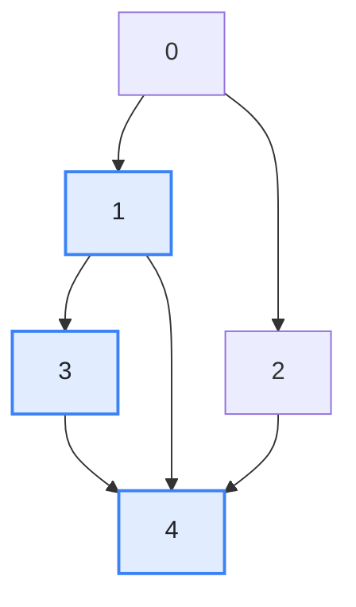
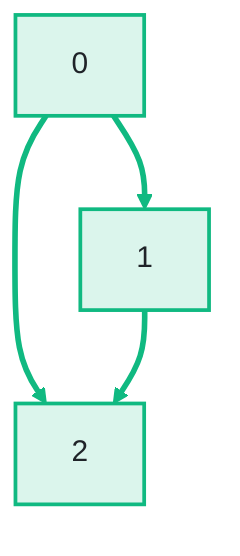
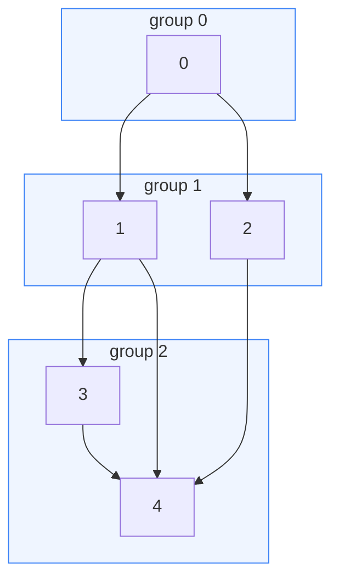
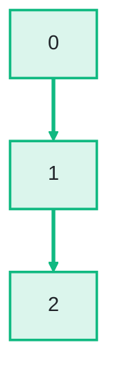

import ChapterProblems from '../../../components/ChapterProblems.astro';
import Compare from '../../../components/Compare.astro';

An analysis often works on a graph derived from the one you have, for example: only some of its
nodes, the same nodes numbered in another order, every edge turned around, or groups of nodes merged
into one node each. The [node IDs](../glossary/#node-id) and [edge indices](../glossary/#edge-index)
change on the way. Your data is kept in arrays by node ID and edge index, so it has to follow.

## Problems in this chapter

<ChapterProblems />

The examples of this chapter use a small program. They work with the calls between its methods, the
package of each method, the lines of code of each method, the steps that build and publish the
program, and the call sites of each call. A call site is a place in the code where one method calls
another.

## Subgraphs and new numberings

A [subgraph](../glossary/#subgraph) keeps some of the nodes of a graph and the edges between them,
and numbers the nodes it keeps anew from 0. A *renumbering* keeps every node and gives it a new node
ID, in an order that suits the next step. Both come with a [mapping](../glossary/#mapping). It
gives, for each node of the new graph, the node ID it has in the old graph. Here is the subgraph of
the nodes 1, 3 and 4:

<Compare
  before="A graph and the nodes to keep"
  after="The subgraph, numbered anew from 0"
  legend={{ inputNode: 'Node to keep', outputNode: 'Kept node with its new node ID', outputEdge: 'Edge between kept nodes' }}
>

</Compare>

| node ID in the subgraph | 0 | 1 | 2 |
|---|---|---|---|
| node ID in the graph | 1 | 3 | 4 |

The mapping carries data over. The value of node 1 of the subgraph is the value of node 3 of the
graph, so a single call turns an array indexed by the old node IDs into one indexed by the new node
IDs. The mapping from old to new node IDs is *partial*: the nodes 0 and 2 have no node in the
subgraph. The edges are numbered anew as well. An edge mapping does for edge indices what the node
mapping does for node IDs.

## Turning the edges around

The [transposed graph](../glossary/#transposed-graph) has the same nodes with the same node IDs, and
every edge is turned around: `a -> b` becomes `b -> a`. It answers questions against the direction
of the edges, such as who calls a method rather than what it calls. Its edge indices differ from
those of the graph, so edge data needs an edge mapping here too.

## Groups

A [partition](../glossary/#partition-and-group) divides the nodes into groups, such as the methods
of a program by package or the servers of a network by data center. Each group is known by its group
ID. The [condensed graph](../glossary/#condensed-graph) has one node for each group, with the group
ID as its node ID. It has an edge between two groups wherever an edge of the graph runs from a node
of the one to a node of the other:

<Compare
  before="A graph, in three groups"
  after="The condensed graph"
  legend={{ inputGroup: 'Group of the partition', outputNode: 'Group as one node', outputEdge: 'From a group to a group its nodes have edges to' }}
>

</Compare>

An edge within a group, such as `3 -> 4` here, has no edge in the condensed graph. The edges from
one group to another become one edge: `1 -> 3`, `1 -> 4` and `2 -> 4` all become `1 -> 2`. A node of
the condensed graph stands for several nodes, and an edge for several edges, so their data cannot be
carried over one to one. It is reduced instead, for example summed, compared or collected in a list.
