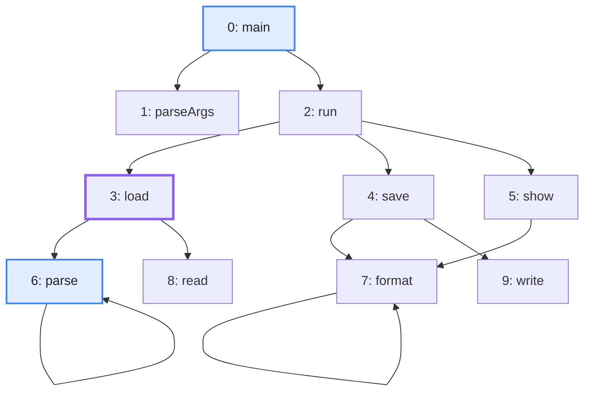
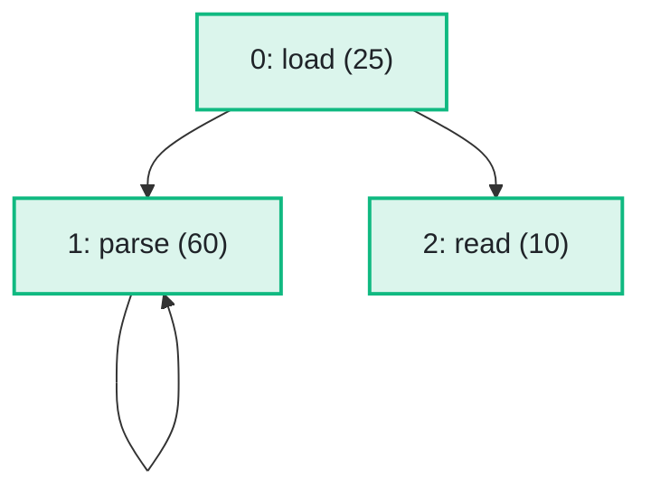

import Example from '../../../components/Example.astro';
import Api from '../../../components/Api.astro';
import Compare from '../../../components/Compare.astro';
import Gap from '../../../components/Gap.astro';
import InCode from '../../../components/InCode.astro';

:::note[In short]
- <Api ref="NodeMapping.gather(int[])" /> carries an array of node data over to the new numbering.
- <Api ref="NodeMapping.inverted(int)" /> turns a [mapping](../../glossary/#mapping) from new to old
  [node IDs](../../glossary/#node-id) into one from old to new.
- <Api ref="IndexMapping.get(int)" /> translates a single node ID.
- <Api ref="NodeMapping.compose(NodeMapping)" /> chains two mappings into one.
:::

## Problem

You derived a new graph from an old one and want your data on the nodes to come along. Your arrays
of node data are indexed by the old node IDs, but an analysis of the new graph needs them in the new
numbering. You also want to translate single node IDs in both directions: the results on the new
graph back to the old nodes, and the old nodes you care about to their new node IDs. This comes up:

- after you take a [subgraph](../../glossary/#subgraph) or renumber the nodes, when an analysis of
  the new graph needs the names, weights or sizes of its nodes;
- when the results of an analysis of the new graph go back into a report on the original nodes;
- after several transformations in a row, each with a mapping of its own.

## Example

The example graph `calls` models the calls between the ten methods of a small program. It has an
edge from each method to each method it calls. An array holds the lines of code of each method. The
graph `loading` is the subgraph of the methods that `load` [reaches](../../glossary/#reach). It
numbers them anew. The mapping
<InCode java="newToOld" rust="new_to_old" ts="newToOld" csharp="newToOld" /> gives the old node ID
of each of its nodes.
See [Take the subgraph of some nodes](../subgraph/) for how to build both. How many lines of code
does each node of the subgraph have? Which node of the subgraph is `parse`, and is `main` in it at
all? The picture after shows the subgraph with the lines of code of each method in brackets:

<Compare
  before="The calls, the method load and the methods to look up"
  after="The subgraph of the methods load reaches, with lines of code"
  legend={{ inputNode: 'Method to look up', contextNode: 'Start node', outputNode: 'Method with its lines of code' }}
>

</Compare>

## Solution

<Example java="guide/TransformingGraphs.java#nodeData" />

<Api ref="NodeMapping.gather(int[])" label="gather" /> builds a new array in the new numbering:
`load`, `parse` and `read` with 25, 60 and 10 lines, as in the picture after. The inverse mapping
finds `parse` as node 1 of the subgraph and has no node for `main`. It is partial, with 3 of its 10
old nodes mapped. The second subgraph has the nodes `parse` and `read`. The composed mapping leads
from them straight to their node IDs in `calls`, which are 6 and 8, so that their lines come from
the original array in one step.

## Good to know

- **Any kind of data.** <InCode java="long[]" rust="Vec<i64>" ts="BigInt64Array" csharp="long[]" /> and
  <InCode java="double[]" rust="Vec<f64>" ts="Float64Array" csharp="double[]" /> carry over the same way;
  for objects, such as names, <Api ref="NodeMapping.gather(T[], T[])" label="NodeMapping.gather(T[], T[])" />
  fills an array you pass.
- **Transformed several times?** Compose the mappings, as at the end of the example, and gather once
  from the original data, instead of gathering after every step. The mapping of the later step is
  the argument and is applied first:
  <InCode java="newToOld.compose(secondToFirst)" rust="new_to_old.compose(&second_to_first)" ts="newToOld.compose(secondToFirst)" csharp="newToOld.Compose(secondToFirst)" />
  leads from the second subgraph to the first and then to `calls`. The other way round, the call
  rejects the mappings. Where their sizes fit, it gives a wrong mapping instead.
- **Unmapped nodes.** In a partial mapping, <Api ref="IndexMapping.get(int)" /> returns
  <InCode java="-1" rust="None" ts="-1" csharp="-1" /> for a node without a counterpart;
  <Api ref="IndexMapping.isMapped(int)" /> checks a node.
- **Results back to the original nodes.** The inverse mapping gathers the other way:
  <InCode java="oldToNew.gather(values)" rust="old_to_new.gather(&values)" ts="oldToNew.gather(values)" csharp="oldToNew.Gather(values)" />
  turns an array by node ID of the subgraph into one by node ID of `calls`, with 0 for the nodes
  that are not in the subgraph. <Api ref="NodeMapping.gather(T[], T[])" label="gather" /> with
  objects leaves their entries as they are. Where 0 is a real value,
  <Api ref="IndexMapping.isMapped(int)" label="isMapped" /> tells whether a node is in the subgraph.
- **Edge data** follows in the same way, through a mapping of the edges. See [Carry edge data over
  to a transformed graph](../edge-data/).
