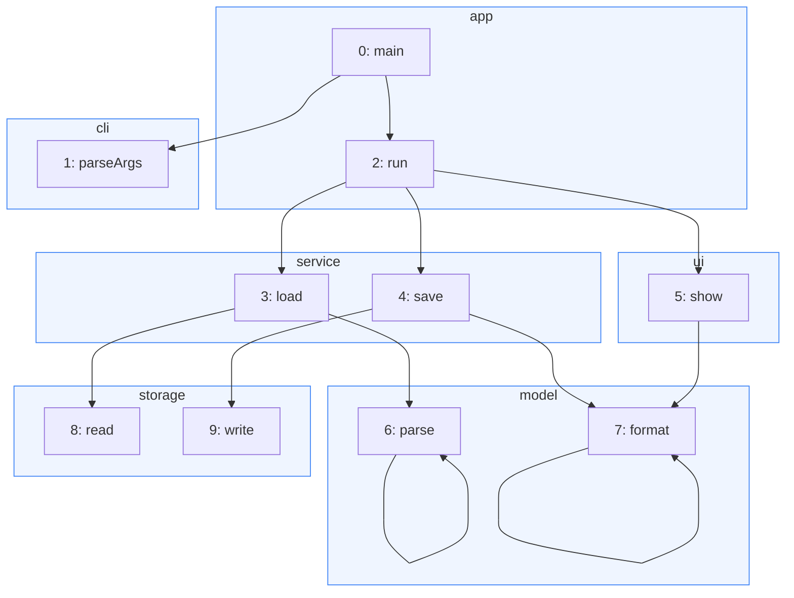
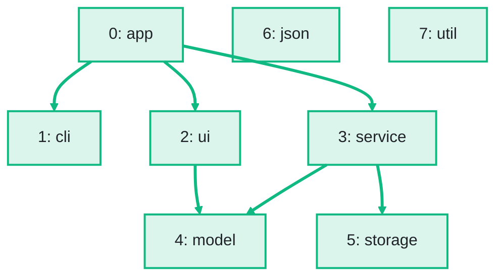

import Example from '../../../components/Example.astro';
import Api from '../../../components/Api.astro';
import Compare from '../../../components/Compare.astro';
import Gap from '../../../components/Gap.astro';
import InCode from '../../../components/InCode.astro';

:::note[In short]
- <Api ref="NodePartition.of(Graph, int[], int)" /> divides the nodes of a graph into
  [groups](../../glossary/#partition-and-group), by a group ID you give for each node.
- <Api ref="NodePartition.condense()" /> builds the [condensed
  graph](../../glossary/#condensed-graph) between the groups, with the group IDs as [node
  IDs](../../glossary/#node-id).
:::

## Problem

You have put the nodes of a graph into groups of your own and want the graph between the groups, for
example: which package calls which, or which data center talks to which. Such a division into groups
is called a [partition](../../glossary/#partition-and-group). The graph between the groups is called
the condensed graph. The groups can be:

- methods grouped by class or package, for the calls between packages;
- servers grouped by data center, for the traffic between data centers;
- tasks grouped by team, for the work that passes from one team to another.

## Example

The example graph `calls` models the calls between the ten methods of a small program. It has an
edge from each method to each method it calls. The program has eight packages: `app`, `cli`, `ui`,
`service`, `model`, `storage`, `json` and `util`. Every method belongs to one of the first six, so
`json` and `util` have no methods. The array
<InCode java="packageOf" rust="package_of" ts="packageOf" csharp="packageOf" /> holds the package of
each method. Which package calls which? The picture before frames the methods by package. The
picture after shows the condensed graph, which holds the calls between the packages:

<Compare
  before="The calls, grouped by package"
  after="The calls between the packages"
  legend={{ inputGroup: 'Methods of a package', outputNode: 'Package with its group ID', outputEdge: 'From a package to a package it calls' }}
>

</Compare>

## Solution

<Example java="guide/TransformingGraphs.java#ownGroups" />

The condensed graph <InCode java="packageCalls" rust="package_calls" ts="packageCalls" csharp="packageCalls" /> has a node for each group,
with the group IDs as node IDs. That makes one node for each of the eight packages. `json` and
`util` have no methods and stay without edges. Calls within a package, such as `main -> run`, are
left out. The two calls from `service` to `model` are `load -> parse` and `save -> format`. They
become one edge, as in the picture after.

## Good to know

- **Nodes in no group.** A group ID of <InCode java="-1" rust="NONE" ts="-1" csharp="-1" /> leaves a node out; its edges
  are left out of the condensed graph too.
- **Empty groups** stay as nodes without edges, so that the group IDs stay node IDs.
- **Groups that Graphity finds.** The [strongly connected
  components](../../glossary/#strongly-connected-component) are a partition that Graphity finds by
  itself. A partition of your own works the same way. See [Condense each group into one node to get
  a DAG](../../sccs/condense-to-dag/) (directed acyclic graph).
- **Cycles between groups.** Unlike the condensed graph of the strongly connected components, the
  condensed graph of groups of your own can have [cycles](../../glossary/#cycle) even where the
  graph has none. For example, the groups `{a, c}` and `{b}` with the edges `a -> b` and `b -> c`
  give an edge each way between the two groups. <Api ref="Graphs.isDag(Graph)" /> tells whether the
  condensed graph has none.
- **Sizes and members.** <Api ref="IndexPartition.groupCount()" /> is the number of groups.
  <Api ref="NodePartition.nodeCount()" /> is the number of nodes of the graph, in a group or not.
  <Api ref="NodePartition.nodesOf(int)" /> lists the nodes of a group.
  <Api ref="IndexPartition.indicesOf(int)" /> lists the members of a group in any partition of nodes
  or edges.
- **The data of the merged nodes and edges.** See
  [Reduce the data of the nodes or edges of a group](../reduce-data/) for this data and the edges
  behind an edge of the condensed graph.
