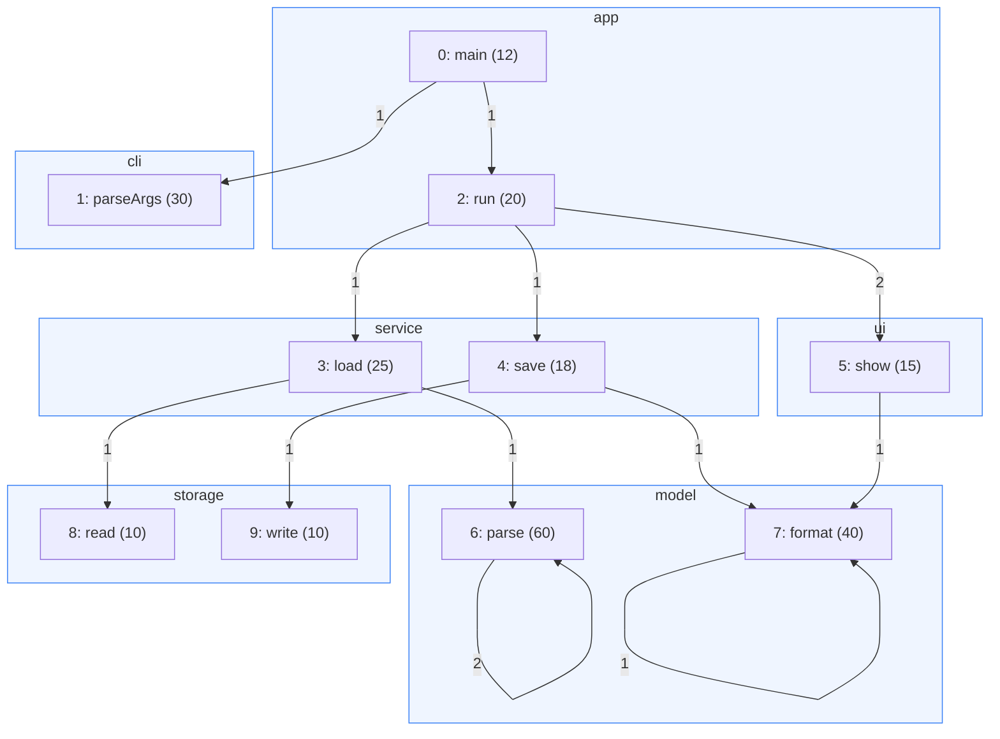
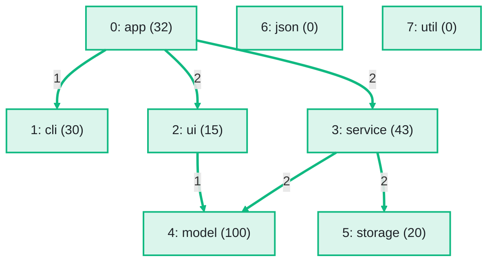

import Example from '../../../components/Example.astro';
import Api from '../../../components/Api.astro';
import Compare from '../../../components/Compare.astro';
import Gap from '../../../components/Gap.astro';
import InCode from '../../../components/InCode.astro';

:::note[In short]
- <Api ref="IndexPartition.reduce(int[], int, IntBinaryOperator)" /> reduces the values of the nodes
  or edges of each [group](../../glossary/#partition-and-group) to one value per group.
- <Api ref="Graphs.edgePartition(Graph, NodePartition)" /> groups the edges of a graph by the edge
  of the [condensed graph](../../glossary/#condensed-graph) they became.
- <Api ref="EdgePartition.edgesOf(int)" /> lists the edges behind an edge of the condensed graph.
:::

## Problem

You have divided nodes or edges into groups and want one value per group, made from the data of its
members. Such a division is called a [partition](../../glossary/#partition-and-group). If you group
nodes, the graph with one node per group is called the condensed graph. Sometimes you also want to
know which edges of the original graph are behind one edge of the condensed graph. You need this
for:

- the lines of code of a package, as the sum over its methods;
- the traffic between two data centers, as the sum over the connections between their servers;
- the label of a group, as the list of the names of its members.

## Example

The example graph `calls` models the calls between the ten methods of a small program. It has an
edge from each method to each method it calls. A place in the code where one method calls another is
called a call site. The array
<InCode java="linesOf" rust="lines_of" ts="linesOf" csharp="linesOf" /> holds the lines of code of
each method. The array
<InCode java="siteCount" rust="site_count" ts="siteCount" csharp="siteCount" /> holds the number of
call sites of each call. The partition
<InCode java="byPackage" rust="by_package" ts="byPackage" csharp="byPackage" /> groups the methods
into eight packages, of which `json` and `util` have no methods. The graph
<InCode java="packageCalls" rust="package_calls" ts="packageCalls" csharp="packageCalls" /> is the
condensed graph, which holds the calls between the packages.
See [Condense groups of your own choice](../own-groups/) for how to build both. How many lines of
code does each package have? Which calls are behind the call from `service` to `model`? How many
call sites does each call between packages have? The picture after shows the condensed graph with
these sums. The lines of code of each package stand in brackets, and the call sites stand on the
edges.

<Compare
  before="The calls, grouped by package"
  after="The calls between the packages, with the sums"
  legend={{ inputGroup: 'Methods of a package', outputNode: 'Package with its lines of code', outputEdge: 'Call with its call sites' }}
>

</Compare>

## Solution

<Example java="guide/TransformingGraphs.java#reduce" />

<InCode java="linesPerPackage" rust="lines_per_package" ts="linesPerPackage" csharp="linesPerPackage" /> has one sum per package. `model` has 100
lines from `parse` and `format`, and `json` and `util` have none. The call `service -> model` stands
for the edges 5 and 7 of the calls: `load -> parse` and `save -> format`. Each of them has one call
site, so `service -> model` has two.
<InCode java="sitesPerPackageCall" rust="sites_per_package_call" ts="sitesPerPackageCall" csharp="sitesPerPackageCall" /> holds
these sums by [edge index](../../glossary/#edge-index) of the condensed graph, as on the edges of
the picture after.

## Good to know

- **Numbers.**
  <Api ref="IndexPartition.reduce(int[], int, IntBinaryOperator)" label="reduce" /> starts each
  group from the identity you pass, such as 0 for a sum, and combines it with the values of the
  members in ascending order. A group without members keeps the identity, and the values of nodes or
  edges in no group are left out. <InCode java="long[]" rust="Vec<i64>" ts="BigInt64Array" csharp="long[]" /> and
  <InCode java="double[]" rust="Vec<f64>" ts="Float64Array" csharp="double[]" /> reduce the same way.
- **Objects.**
  <Api ref="IndexPartition.reduce(T[], T[], BinaryOperator)" label="IndexPartition.reduce(T[], T[], ...)" />
  reduces objects, such as lists of names, without an identity. It starts each group from the value
  of its first member and writes the results into an array you pass. In that array, a group without
  members keeps the entry it has.
- **Edges in no group.** The condensed graph has no edge for two kinds of edges, so they are in no
  group of the edge partition: edges inside a group, and edges from or to a node in no group.
  <Api ref="EdgePartition.edgeCount()" /> is the number of edges of the graph, in a group or not.
- **The condensed graph of the same partition.**
  <Api ref="Graphs.edgePartition(Graph, NodePartition)" /> takes the graph that
  <Api ref="NodePartition.condense()" /> of the same partition returned. It checks only the node
  count, so another graph with as many nodes gives wrong groups without an error.
