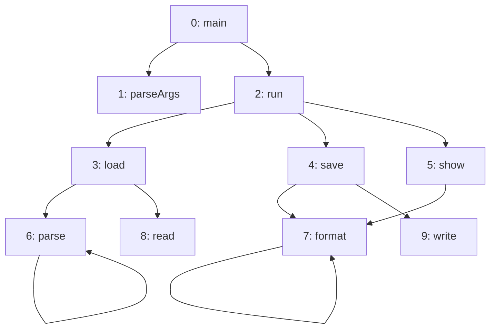
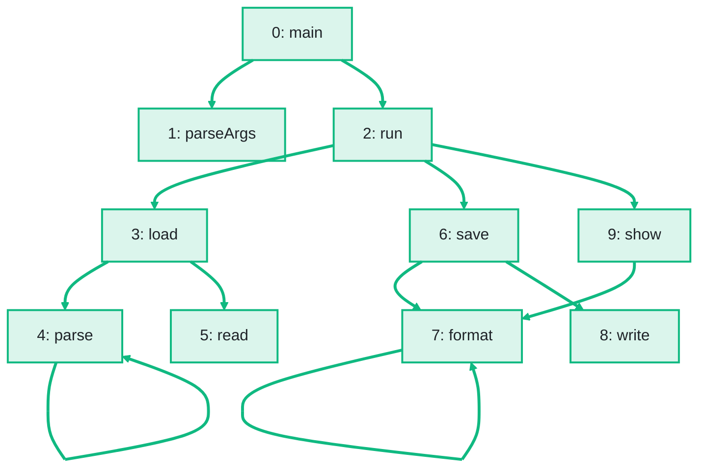

import Example from '../../../components/Example.astro';
import Api from '../../../components/Api.astro';
import Compare from '../../../components/Compare.astro';
import Gap from '../../../components/Gap.astro';
import InCode from '../../../components/InCode.astro';

:::note[In short]
- <Api ref="NodeMapping.reindex(Graph)" /> numbers the nodes in the order of a [depth-first
  search](../../glossary/#depth-first-search).
- <Api ref="NodeMapping.forPermutation(IntList)" /> numbers them in an order you give, such as the
  [topological order](../../glossary/#topological-order) from <Api ref="TopOrder.of(Graph)" />.
- <Api ref="Graphs.remapped(Graph, NodeMapping)" /> builds the renumbered graph.
:::

## Problem

You want the nodes of a graph numbered in an order that suits your next step. The
[node IDs](../../glossary/#node-id) of a graph often follow from how it was built, such as the order
in which a parser met the methods or in which the rows of a database came. Another numbering helps
in these cases:

- Many searches run over a large graph. In the order of a depth-first search, nodes that the search
  visits one after another get adjacent node IDs. Later searches then read the arrays of the graph
  more sequentially, which can make these searches faster.
- A loop runs over the nodes by node ID, such as the steps of a build plan. In a topological order,
  the loop meets the [source](../../glossary/#source-and-target) of every edge before its target.
- A report lists the nodes by node ID. If you number them by name, every list of node IDs comes out
  sorted by name.

## Example

The first example graph `calls` models the calls between the ten methods of a small program. It has
an edge from each method to each method it calls. A depth-first search from `main` (node 0) visits
the methods in an order of its own. What node ID does each method get in that order?

The second example graph `steps` models the steps that build and publish the program. It has an edge
`a -> b` if step `b` may start only after step `a`. The steps get the node IDs of a topological
order.

The picture after shows the calls with their new node IDs:

<Compare
  before="The calls between the methods"
  after="The calls, numbered in depth-first order"
  legend={{ outputNode: 'Method with its new node ID', outputEdge: 'From a method to a method it calls' }}
>

</Compare>

## Solution

<Example java="guide/TransformingGraphs.java#renumber" />

Both [mappings](../../glossary/#mapping) go from new to old node IDs. In depth-first order, `load`
keeps node ID 3 and is followed by the methods it calls: `parse` and `read`. Only then come `save`
and the methods it calls, and `show` comes last. In the topological order, the steps start with
`lint` and `generate`, which wait for no other step. Every edge of
<InCode java="inRunOrder" rust="in_run_order" ts="inRunOrder" csharp="inRunOrder" /> leads to a higher node ID.

## Good to know

- **Where the search starts.** <Api ref="NodeMapping.reindex(Graph)" /> starts at node 0, takes
  the [out-nodes](../../glossary/#out-node-and-in-node) of each node in ascending order, and starts
  again at the smallest node it has not visited, until every node has a new node ID. For another
  start node, collect the nodes in a list `order` in
  <Api ref="DfsTraverser.enterNode(int)" label="enterNode" />, in the order a
  <Api ref="DfsTraverser" /> enters them. Run it for the start node with
  <Api ref="DfsTraverser.run(int)" label="run(start)" />, then for the rest with
  <Api ref="DfsTraverser.run()" label="run()" />. See
  [Write a depth-first search without recursion](../../searches/dfs/) for such a traverser. Pass
  <InCode java="order" rust="&order" ts="order" csharp="CollectionsMarshal.AsSpan(order)" />, which
  holds every node once, to <Api ref="NodeMapping.forPermutation(IntList)" />.
- **A mapping of your own.** <Api ref="NodeMapping.of(int[])" /> takes an array from new to old node
  IDs, for any numbering you compute yourself.
- **A topological order needs a [DAG](../../glossary/#dag) (directed acyclic graph).**
  <Api ref="TopOrder.of(Graph)" /> rejects a graph with a [cycle](../../glossary/#cycle). See [Put
  the nodes in dependency order](../../order-and-cycles/topological-order/). For a graph with
  cycles, see [Put the nodes in dependency order although the graph has
  cycles](../../sccs/order-despite-cycles/).
- **The data follows** the new numbering. Node data follows through the same mapping. See [Carry
  node data over to a transformed graph](../node-data/). The
  [edge indices](../../glossary/#edge-index) change too. See [Carry edge data over to a transformed
  graph](../edge-data/).
- **Renumbering for speed** costs a depth-first search and a copy of the graph. On a large graph
  that many searches follow, it can make them faster; on a small graph, it makes no difference.
