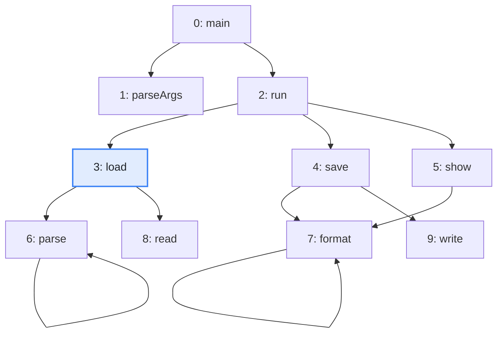
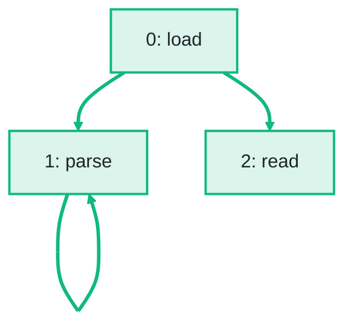

import Example from '../../../components/Example.astro';
import Api from '../../../components/Api.astro';
import Compare from '../../../components/Compare.astro';
import Gap from '../../../components/Gap.astro';
import InCode from '../../../components/InCode.astro';

:::note[In short]
- <Api ref="NodeMapping.forSubgraph(IntList)" label="NodeMapping.forSubgraph(IntList)" /> makes a
  [mapping](../../glossary/#mapping) that numbers the selected nodes anew from 0, in ascending order
  of their [node IDs](../../glossary/#node-id).
- <Api ref="Graphs.remapped(Graph, NodeMapping)" /> builds the graph of those nodes and the edges
  between them.
:::

## Problem

You want to work on some of the nodes of a graph and the edges between them, and leave out the rest.
Running each analysis on the whole graph and filtering its results is wasteful and easy to get
wrong. A graph of only those nodes and edges is called a [subgraph](../../glossary/#subgraph). On a
subgraph, the analyses see only the nodes that matter. The nodes you keep can be:

- the code that a method [reaches](../../glossary/#reach), for an analysis of what it may run;
- the modules of one team, or of one layer of an architecture;
- the nodes that pass a filter, such as the classes that a commit changed.

## Example

The example graph `calls` models the calls between the ten methods of a small program. It has an
edge from each method to each method it calls. The array `names` holds the names of the methods.
`parse` and `format` call themselves. Which methods does `load` reach, and how do they call each
other? They should form a graph of their own, for the analyses that follow. The picture after shows
the subgraph that the code returns, with its new node IDs:

<Compare
  before="The calls and the method load"
  after="The subgraph of the methods load reaches"
  legend={{ inputNode: 'Start node', outputNode: 'Method with its new node ID', outputEdge: 'From a method to a method it calls' }}
>

</Compare>

## Solution

<Example java="guide/TransformingGraphs.java#subgraph" />

The subgraph `loading` has three nodes, numbered 0 to 2 in the order of their old node IDs: `load`,
`parse` and `read`. It keeps the calls between them. The mapping
<InCode java="newToOld" rust="new_to_old" ts="newToOld" csharp="newToOld" /> gives the old node ID of each new node, and
<Api ref="NodeMapping.gather(T[], T[])" label="NodeMapping.gather" /> carries the names over with
it. The second subgraph has the nodes `save`, `show`, `format` and `write`, in this order.

## Good to know

- **Three ways to select.** A sorted list that Graphity returned, such as the result of a search,
  goes to <Api ref="NodeMapping.forSubgraph(IntList)" label="NodeMapping.forSubgraph(IntList)" /> as
  it is. Node IDs written out or in an array can come in any order. They go to
  <Api ref="NodeMapping.forSubgraph(int...)" label="NodeMapping.forSubgraph(int...)" />, which sorts
  them in a copy. Nodes that a filter marked in a
  <InCode java="BitSet" rust="[bool]" ts="BitSet" csharp="BitArray" /> go to
  <Api ref="NodeMapping.forSubgraph(BitSet)" label="NodeMapping.forSubgraph(BitSet)" />. A list in
  any order that Graphity returned, such as a [cycle](../../glossary/#cycle) that it found, is
  sorted in a copy as well:
  <InCode java="NodeMapping.forSubgraph(cycle)" rust="NodeMapping::for_subgraph(&cycle)?" ts="NodeMapping.forSubgraph(cycle)" csharp="NodeMapping.ForSubgraph(cycle.AsSpan())" />.
- **Only the edges between selected nodes.** An edge from or to a node that is left out is left out
  as well.
- **The data comes along** through the mapping. See [Carry node data over to a transformed
  graph](../node-data/) and [Carry edge data over to a transformed graph](../edge-data/).
- **Condense instead of leave out.** You can also replace groups of nodes by one node each, rather
  than drop nodes. See [Condense groups of your own choice](../own-groups/).

<Gap>
Take the subgraph of some edges. It would have every node and only the edges that pass a filter,
such as the calls that cross a package boundary, and an edge mapping to the original graph. Graphity
selects nodes only. Today, the graph has to be built again without the other edges.
See [Remove edges to break every cycle](../../order-and-cycles/break-cycles/) for an example.
</Gap>
