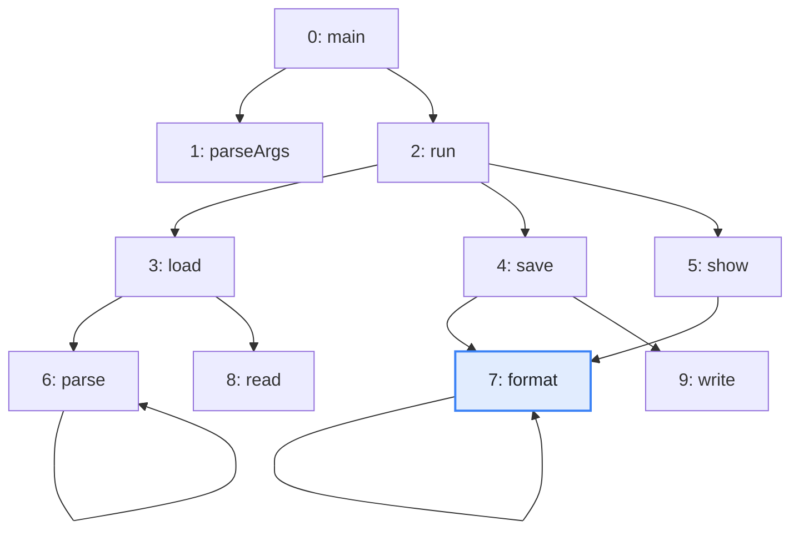
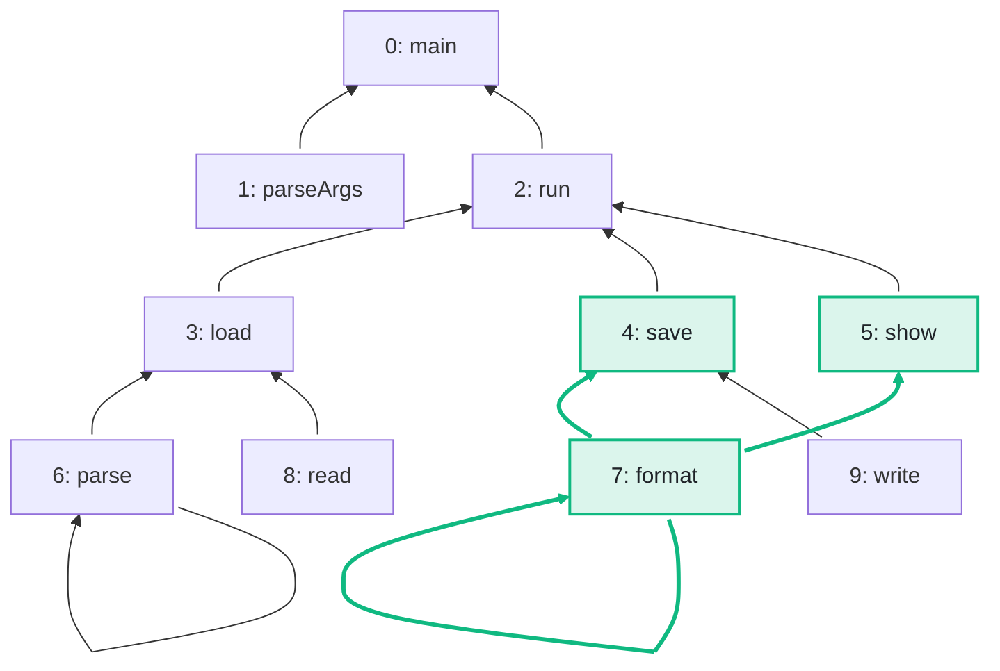

import Example from '../../../components/Example.astro';
import Api from '../../../components/Api.astro';
import Compare from '../../../components/Compare.astro';
import Gap from '../../../components/Gap.astro';
import InCode from '../../../components/InCode.astro';

:::note[In short]
- <Api ref="BiAdjacentGraph.of(Graph)" /> adds the [in-nodes](../../glossary/#out-node-and-in-node)
  that a plain graph lacks.
- <Api ref="BiAdjacentGraph.transposed()" /> then returns the [transposed
  graph](../../glossary/#transposed-graph) without copying. In it, every edge is turned around.
- <Api ref="Graphs.transposedEdgeMapping(Graph)" /> returns the [mapping](../../glossary/#mapping)
  from the edges of the transposed graph to those of the graph. Its
  <Api ref="EdgeMapping.gather(int[])" label="gather" /> carries edge data over to the [edge
  indices](../../glossary/#edge-index) of the transposed graph.
:::

## Problem

You want to follow the edges of a graph the other way round. The graph with every edge turned around
is called the transposed graph. Every algorithm that follows edges works on it as well, so you need
no new algorithm. The [node IDs](../../glossary/#node-id) stay the same. The edge indices of the
transposed graph differ, so edge data needs translating. You need this for:

- the callers of a method instead of the methods it calls;
- the packages that use a package instead of those it uses;
- the [paths](../../glossary/#path) to an [exit](../../glossary/#entry-and-exit) of a function
  instead of the paths from its entry.

## Example

The example graph `calls` models the calls between the ten methods of a small program. It has an
edge from each method to each method it calls. The array `names` holds the names of the methods. A
place in the code where one method calls another is called a call site. The array
<InCode java="siteCount" rust="site_count" ts="siteCount" csharp="siteCount" /> holds the number of
call sites of each call. The variable
<InCode java="loadToRead" rust="load_to_read" ts="loadToRead" csharp="loadToRead" /> holds the edge
index of the call `load -> read`. Which methods call `format`, and from how many places each? The
transposed graph has an edge from each method to each method that calls it, so the answer is the
out-nodes of `format` there. The picture after shows the transposed graph, with the callers of
`format` and the edges to them:

<Compare
  before="The calls and the method format"
  after="The transposed graph and the callers of format"
  legend={{ inputNode: 'Called method', outputNode: 'Caller', outputEdge: 'Edge to a caller' }}
>

</Compare>

## Solution

<Example java="guide/TransformingGraphs.java#transposed" />

In the transposed graph <InCode java="calledBy" rust="called_by" ts="calledBy" csharp="calledBy" />, the out-nodes of `format` are
its callers, as in the picture after: `save`, `show` and `format` itself, each with one call site.
The number of call sites comes from <InCode java="calledBySiteCount" rust="called_by_site_count" ts="calledBySiteCount" csharp="calledBySiteCount" />,
which holds it by edge index of the transposed graph. The edge `load -> read` is edge index 6 of the
calls. Turned around to `read -> load`, it is edge index 10 of the transposed graph.

## Good to know

- **No copy.** <Api ref="BiAdjacentGraph.transposed()" /> swaps the in-nodes and out-nodes of a
  <Api ref="BiAdjacentGraph" />: the result is a view that costs no time and no memory. A plain
  <Api ref="Graph" /> needs <Api ref="BiAdjacentGraph.of(Graph)" /> once, which builds the in-nodes.
- **The two directions.** <Api ref="BiAdjacentGraph.transposedEdgeIndex(int)" /> translates an edge
  index of the graph into the edge index of the turned-around edge in the transposed graph.
  <Api ref="Graphs.transposedEdgeMapping(Graph)" /> maps the other way: from each edge of the
  transposed graph to the edge of the graph it turns around.
  <Api ref="EdgeMapping.gather(int[])" label="gather" /> needs this direction to carry data over to
  the transposed graph. Called on the transposed graph,
  <Api ref="BiAdjacentGraph.transposedEdgeIndex(int)" label="transposedEdgeIndex" /> translates
  back.
- **Every search works backwards this way.** See [Find everything that reaches a
  node](../../reachability/reaching/).
