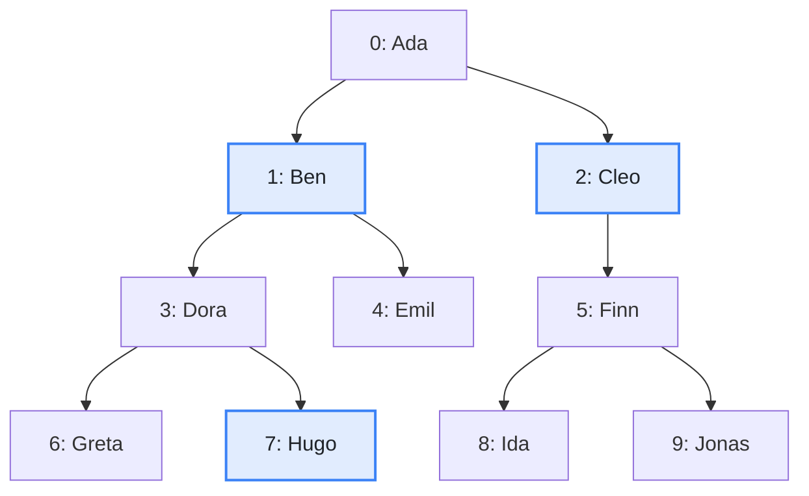
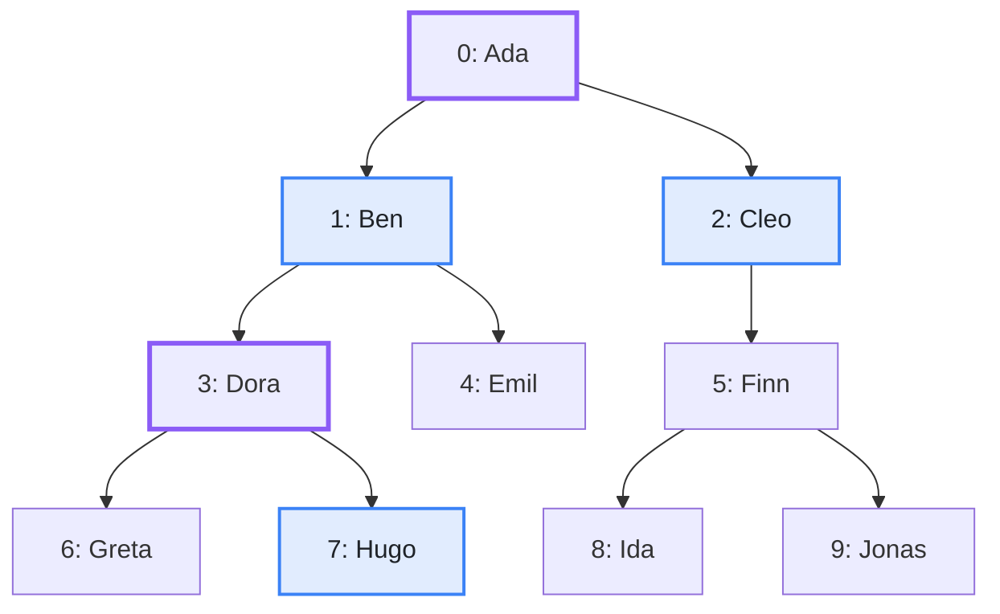

import Example from '../../../components/Example.astro';
import Api from '../../../components/Api.astro';
import Compare from '../../../components/Compare.astro';
import Gap from '../../../components/Gap.astro';
import InCode from '../../../components/InCode.astro';

:::note[In short]
- <Api ref="Ancestry.of(Graph)" /> builds an index of a [forest](../../glossary/#tree-and-forest)
  whose edges point from [parent](../../glossary/#parent-and-child) to child.
- <Api ref="Ancestry.isAncestorOf(int, int)" /> tells whether one node is an
  [ancestor](../../glossary/#ancestor-and-descendant) of another: whether it lies on the
  [path](../../glossary/#path) from the [root](../../glossary/#root-node) to the other.
- <Api ref="PreorderAncestry.of(Ancestry)" /> adds an index that answers the same in constant time.
  Use it when the test runs very often.
:::

## Problem

You want to know whether one node lies above another in a hierarchy, and you ask that very often.
In a [tree](../../glossary/#tree-and-forest), a node that lies above another is called its ancestor.
An analysis may ask this for every pair of nodes it looks at. That can be millions of times, so each
answer should be cheap. You need this to find out:

- whether an expression lies inside a given loop or block of a program;
- whether an employee belongs to a department, directly or through one of its sub-departments;
- whether a file lies in a folder or in one of its subfolders;
- whether a person descends from another.

## Example

The example graph `family` models a family tree that records one
[parent](../../glossary/#parent-and-child) per person. It has an edge from each parent to each
child. Is `Ben` an ancestor of `Hugo`? Is `Cleo`? Is `Hugo` himself?

<Compare
  before="The family tree and the people asked about"
  after="The people asked about and the other ancestors of Hugo"
  legend={{ inputNode: 'Person asked about', contextNode: 'Other ancestor of Hugo' }}
>

</Compare>

The ancestors of `Hugo` are the nodes on the path from the root to him, including `Hugo` himself.
In the picture after, `Ben` and `Hugo` are two of them and `Cleo` is not. `Ada` and `Dora` are the
other ancestors, whom the example does not ask about.

## Solution

<Example java="guide/ReadingAncestry.java#isAncestorOf" />

`Ben` is the grandfather of `Hugo` and so an ancestor of him. `Cleo` is his great-aunt and no
ancestor of him. `Hugo` is his own ancestor. The index with the
[preorder](../../glossary/#subtree-and-preorder) gives the same answers, each in constant time
instead of logarithmic time.

## Good to know

- **Which index.** <Api ref="Ancestry" /> answers in logarithmic time at most, however deep the
  tree. <Api ref="PreorderAncestry" /> answers in constant time and shares the arrays of the index
  it is built from. Building it takes time and memory of its own, so for a few tests the ancestor
  index is enough.
- **How the index with the preorder answers.** It lists the nodes in preorder, in which every
  subtree takes a range of consecutive positions. So a node `a` is an ancestor of a node `b` exactly
  if the position of `b` lies in the range of the subtree of `a`. See
  [List a node and all its descendants](../subtrees/).
- **A node is its own ancestor** in both indexes.
- **The [lowest common ancestor](../../glossary/#lowest-common-ancestor)** of two nodes comes from
  the same index. See [Find the lowest common ancestor of two nodes](../common-ancestor/).
- **Not a tree?** In a [DAG](../../glossary/#dag) (directed acyclic graph), a node is an ancestor of
  another exactly if it [reaches](../../glossary/#reach) it. A family with both parents recorded is
  such a graph. For many such tests, see
  [Answer many reachability questions at once](../../reachability/transitive-closure/).
