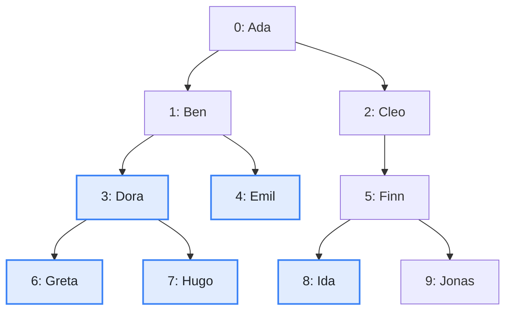
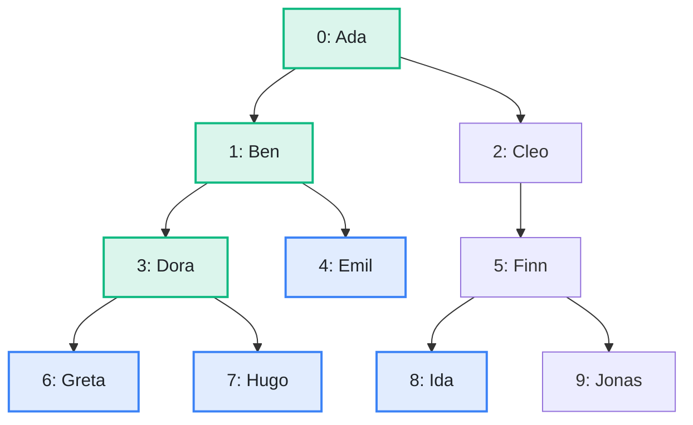

import Example from '../../../components/Example.astro';
import Api from '../../../components/Api.astro';
import Compare from '../../../components/Compare.astro';
import Gap from '../../../components/Gap.astro';
import InCode from '../../../components/InCode.astro';

:::note[In short]
- <Api ref="Ancestry.of(Graph)" /> builds an index of a [forest](../../glossary/#tree-and-forest)
  whose edges point from [parent](../../glossary/#parent-and-child) to child.
- <Api ref="Ancestry.lowestCommonAncestorOf(int, int)" /> returns the
  [lowest common ancestor](../../glossary/#lowest-common-ancestor) of two nodes: the deepest node
  that is an [ancestor](../../glossary/#ancestor-and-descendant) of both. It returns
  <InCode java="-1" rust="None" ts="-1" csharp="-1" /> if they are in different
  [trees](../../glossary/#tree-and-forest).
:::

## Problem

You have two nodes in a hierarchy and want the first node they share on the way up to the top. Two
nodes in the same tree have the [root](../../glossary/#root-node) as a common ancestor, but you want
the deepest one. It is called the lowest common ancestor. It is the last node that the
[paths](../../glossary/#path) from the root to the two nodes have in common. You need this to find:

- the innermost element of a syntax tree that encloses two expressions;
- the smallest folder that contains two files;
- the lowest manager who is responsible for two employees;
- the most recent common ancestor of two people in a family tree that records one parent per
  person.

## Example

The example graph `family` models a family tree that records one
[parent](../../glossary/#parent-and-child) per person. It has an edge from each parent to each
child. What is the lowest common ancestor of the second cousins `Greta` and `Ida`? What is it for
`Greta` and her uncle `Emil`, for the siblings `Hugo` and `Greta`, and for `Dora` and her son
`Hugo`?

<Compare
  before="The family tree and the people asked about"
  after="The lowest common ancestors of the four pairs"
  legend={{ inputNode: 'Person asked about', outputNode: 'Lowest common ancestor' }}
>

</Compare>

The picture after shows the results of all four questions: `Ada`, `Ben` and `Dora`. `Dora` is also
one of the people asked about. `Ada` is the lowest common ancestor of `Greta` and `Ida`: the paths
from the root to the two of them have only `Ada` in common.

## Solution

<Example java="guide/ReadingAncestry.java#lowestCommonAncestor" />

`Ada` is the lowest common ancestor of `Greta` and `Ida`. `Ben` is that of `Greta` and her uncle
`Emil`, and `Dora` is that of the siblings `Hugo` and `Greta`. A node is its own ancestor, so the
lowest common ancestor of `Dora` and her son `Hugo` is `Dora` herself.

## Good to know

- **A node is its own ancestor**, so the lowest common ancestor of a node and one of its descendants
  is the node itself. One node is therefore an ancestor of another exactly if it is the lowest
  common ancestor of the two. See
  [Test many times whether one node is an ancestor of another](../ancestor-test/).
- **Different trees.** In a forest, two nodes in different trees have no common ancestor, and the
  result is <InCode java="-1" rust="None" ts="-1" csharp="-1" />.
- **Dominance.** <Api ref="Ancestry.of(Dominators)" /> builds the same index for the
  [dominator tree](../../glossary/#dominator) of a
  [control-flow graph](../../glossary/#control-flow-graph). There, the lowest common ancestor of two
  blocks is the lowest block that dominates both. See
  [Build the dominator tree and ask it questions](../../dominance/dominator-tree/).

<Gap>
Find the lowest common ancestors of two people in a family with both parents recorded. Such a family
is a [DAG](../../glossary/#dag) (directed acyclic graph), not a tree: a person has two
[in-nodes](../../glossary/#out-node-and-in-node). Two people can have several lowest common
ancestors, such as the two parents of two siblings. Their common ancestors are the nodes that
[reach](../../glossary/#reach) both. These are the nodes in both results of two searches on the
[transposed graph](../../glossary/#transposed-graph).
See [Find everything that reaches a node](../../reachability/reaching/) for such a search. Graphity
does not pick the lowest of them, which are those that reach no other common ancestor.
</Gap>
