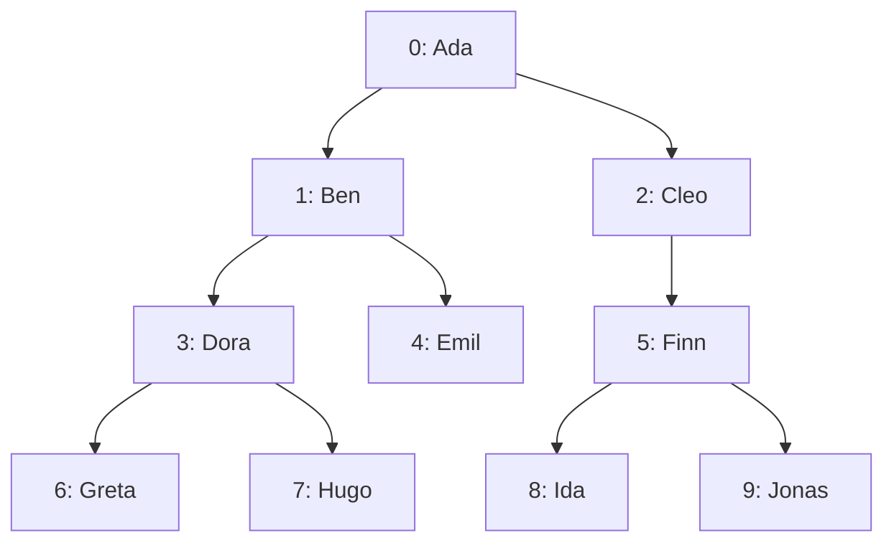

import Api from '../../../components/Api.astro';
import ChapterProblems from '../../../components/ChapterProblems.astro';

Many graphs are hierarchies, for example the syntax tree of a program, the folders of a file system,
the organization of a company or a family. In a hierarchy, every node but the
[root](../glossary/#root-node) has exactly one [parent](../glossary/#parent-and-child). The
questions are about [ancestors and descendants](../glossary/#ancestor-and-descendant): whether one
node lies on the [path](../glossary/#path) from the root to another, which node is the deepest
ancestor that two nodes share, and which nodes descend from a node.

## Problems in this chapter

<ChapterProblems />

The examples of this chapter use a family tree over four generations. It records one parent per
person and has an edge from each parent to each child.
One example also uses the packages of a small program as a graph that is no
[forest](../glossary/#tree-and-forest). See
[Find out whether a graph is a tree, a forest or a path](shapes/).

## Trees and forests

A [forest](../glossary/#tree-and-forest) is a graph without [cycles](../glossary/#cycle) in which
every node has at most one [in-node](../glossary/#out-node-and-in-node). This in-node is the parent
of the node. The nodes without a parent are the root nodes, and the edges point away from them. A
tree is a forest with at most one root node. The [depth](../glossary/#depth) of a node is the number
of edges on the path from its root to it. In a family tree, the depth is the generation.

`Ada` is the root and has depth 0. Her children `Ben` and `Cleo` have depth 1. Her
great-grandchildren `Greta`, `Hugo`, `Ida` and `Jonas` have depth 3.

## Ancestors and descendants

A node `a` is an ancestor of a node `b` if `a` lies on the path from the root to `b`. `b` is then a
descendant of `a`. By the convention of this guide and of Graphity, a node is its own ancestor and
its own descendant. The [lowest common ancestor](../glossary/#lowest-common-ancestor) of two nodes
is the deepest node that is an ancestor of both: for `Greta` and `Emil`, it is `Ben`. The
[subtree](../glossary/#subtree-and-preorder) of a node is the node with all its descendants: the
subtree of `Ben` holds `Ben`, `Dora`, `Emil`, `Greta` and `Hugo`.

## One index for all the questions

Graphity answers these questions with an index of a forest, which you build once.
<Api ref="Ancestry" /> gives the parent and the depth of each node, tells whether one node is an
ancestor of another, and finds the lowest common ancestor of two nodes.

<Api ref="PreorderAncestry" /> adds the [preorder](../glossary/#subtree-and-preorder) of the forest.
The preorder is a list of the nodes in which each node is followed by the subtrees of its children,
one after the other. Here, it lists `Ada`, then the subtree of `Ben`, then the subtree of `Cleo`. In
the preorder, each subtree takes a range of consecutive positions. So the subtree of a node is that
range. A node `a` is an ancestor of a node `b` exactly if the position of `b` lies in the range of
the subtree of `a`.
