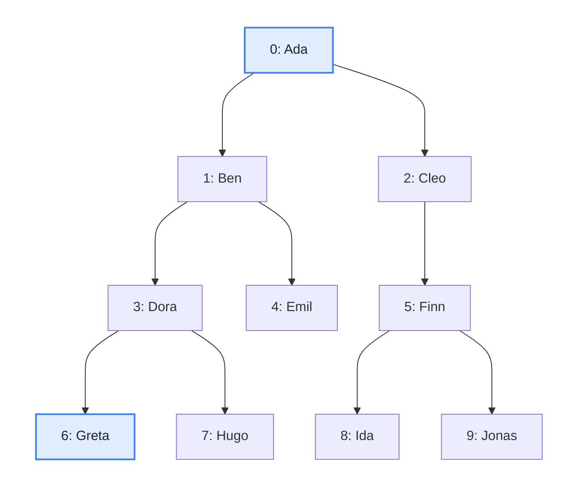
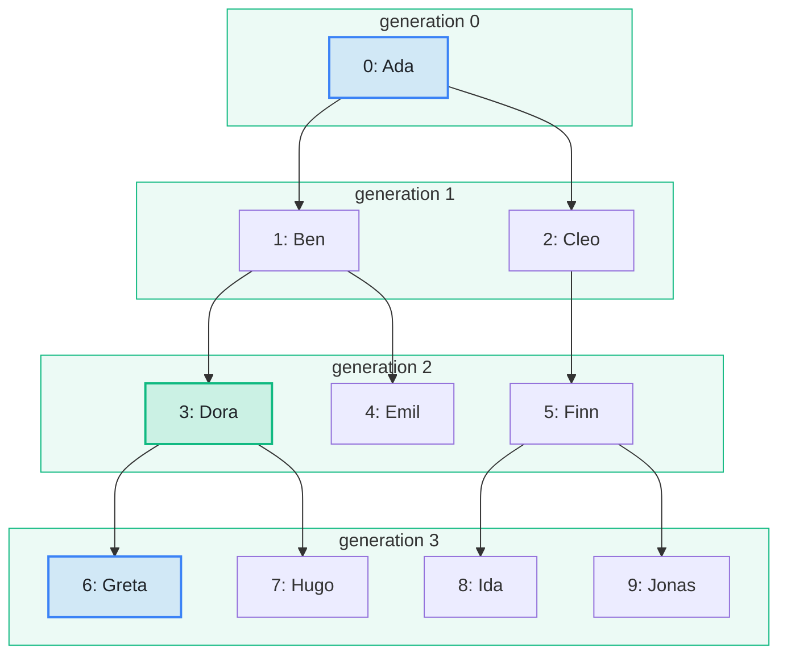

import Example from '../../../components/Example.astro';
import Api from '../../../components/Api.astro';
import Compare from '../../../components/Compare.astro';
import Gap from '../../../components/Gap.astro';
import InCode from '../../../components/InCode.astro';

:::note[In short]
- <Api ref="Ancestry.of(Graph)" /> builds an index of a [forest](../../glossary/#tree-and-forest)
  whose edges point from [parent](../../glossary/#parent-and-child) to child.
- <Api ref="Ancestry.parentOf(int)" /> returns the parent of a node, or
  <InCode java="-1" rust="None" ts="-1" csharp="-1" /> for a [root node](../../glossary/#root-node).
- <Api ref="Ancestry.depthOf(int)" /> returns its [depth](../../glossary/#depth): the number of
  edges from its root to it.
:::

## Problem

You have a hierarchy and want to know where each node sits in it: which node is directly above it,
and how far below the top it lies. The node directly above a node is called its parent. The number
of edges from the root down to a node is called its depth. You want both for every node, in one
index that also answers questions about [ancestors](../../glossary/#ancestor-and-descendant). You
need this to find:

- the enclosing element of a node in a syntax tree, and how deeply it is nested;
- the manager of an employee, and the level of management;
- the folder of a file, and how deeply it is nested.

## Example

The example graph `family` models a family tree that records one parent per person. It has an edge
from each parent to each child. Who is the parent of `Greta`, and in which generation is she? Who is
the parent of `Ada`? And in which generation is each of the others?

<Compare
  before="The family tree and the people asked about"
  after="The generations and the parent of Greta"
  legend={{ inputNode: 'Person asked about', outputNode: 'Parent', outputGroup: 'Generation' }}
>

</Compare>

In the picture after, the frames show the generation of every person. The generation is the depth
that the index returns. `Dora` is the parent of `Greta`. `Ada` is the root and has no parent.

## Solution

<Example java="guide/ReadingAncestry.java#parentOf" />

`Dora` is the parent of `Greta`, who is three generations below `Ada`. `Ada` is the root and has no
parent, so <Api ref="Ancestry.parentOf(int)" /> returns
<InCode java="-1" rust="None" ts="-1" csharp="-1" /> for her. The depths of all the people are the
generations of the picture after.

## Good to know

- **Only for forests.** <Api ref="Ancestry.of(Graph)" /> rejects a graph in which a node has more
  than one [in-node](../../glossary/#out-node-and-in-node), or which has a
  [cycle](../../glossary/#cycle)
  (<InCode java="IllegalArgumentException" rust="ErrorKind::InvalidArgument" ts="Error" csharp="ArgumentException" />).
  If the graph may not be a forest, check it with <Api ref="Graphs.isForest(Graph)" /> first. See
  [Find out whether a graph is a tree, a forest or a path](../shapes/).
- **One index, many questions.** The same <Api ref="Ancestry" /> finds the
  [lowest common ancestor](../../glossary/#lowest-common-ancestor) of two nodes and tells whether
  one node is an ancestor of another. See
  [Find the lowest common ancestor of two nodes](../common-ancestor/) and
  [Test many times whether one node is an ancestor of another](../ancestor-test/).
- **Edges from child to parent.** Build the index of the
  [transposed graph](../../glossary/#transposed-graph): <Api ref="BiAdjacentGraph.transposed()" />
  of <Api ref="BiAdjacentGraph.of(Graph)" />.
- **The parent alone** is also the single in-node of a node, which
  <Api ref="BiAdjacentGraph.inNodes(int)" /> returns. The depths and the questions about ancestors
  need the ancestor index.
