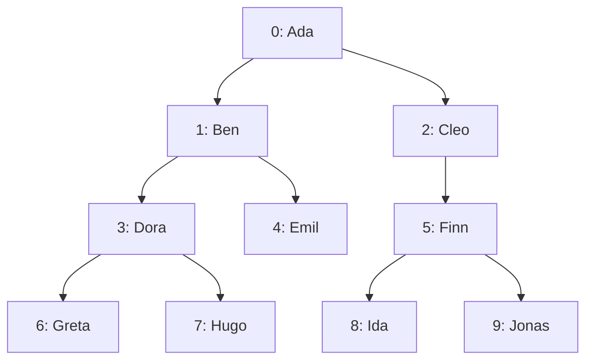
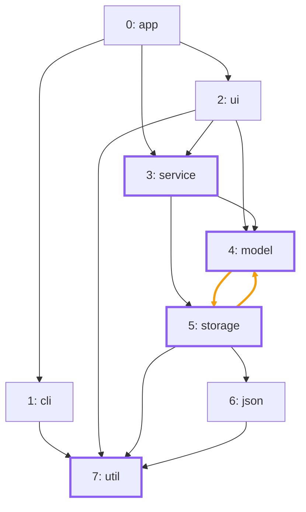

import Example from '../../../components/Example.astro';
import Api from '../../../components/Api.astro';
import Compare from '../../../components/Compare.astro';
import Gap from '../../../components/Gap.astro';
import InCode from '../../../components/InCode.astro';

:::note[In short]
- <Api ref="Graphs.isForest(Graph)" /> tells whether a graph has no [cycles](../../glossary/#cycle)
  and every node has at most one [in-node](../../glossary/#out-node-and-in-node): a
  [forest](../../glossary/#tree-and-forest).
- <Api ref="Graphs.isTree(Graph)" /> tells whether it is a forest with at most one
  [root node](../../glossary/#root-node): a tree.
- <Api ref="Graphs.isPath(Graph)" /> tells whether it is a tree in which every node has at most one
  out-node: a [path](../../glossary/#path).
:::

## Problem

You have data that should be a hierarchy and want to make sure that it is one. It may have a
category with two [parents](../../glossary/#parent-and-child), a reference that closes a cycle, or a
second root. You want to know this before you treat the graph as a tree, that is, before you index
its [ancestors](../../glossary/#ancestor-and-descendant), list it in
[preorder](../../glossary/#subtree-and-preorder) or walk it from the root. A graph with several
roots can still be a forest: several trees side by side. The strictest shape is a path: a tree in
which every node has at most one child. Some algorithms need that shape. You need this for:

- a hierarchy read from a file or a database, such as categories or folders;
- a graph that a program builds and that should be a tree, such as a syntax tree;
- a sequence of steps that should be a path, such as the versions of a document.

## Example

The example checks three graphs:

- The first graph `family` models a family tree that records one parent per person. It has an edge
  from each parent to each child.
- The second graph `line` models one line of descent in that family, from `Ada` through `Cleo` and
  `Finn` to `Ida`. It is built as a graph of its own, with an edge from each of them to the next.
- The third graph `dependencies` models the packages of a small program. It has an edge from each
  package to each package it uses. `app` and `ui` both use `service`, and `model` and `storage` use
  each other.

Which of them are forests, trees or paths?

<Compare
  before="The family tree"
  after="The packages, not a forest"
  legend={{ contextNode: 'Package with more than one in-node' }}
>

</Compare>

In the picture after, `service`, `model`, `storage` and `util` are packages with more than one
in-node, and the edges between `model` and `storage` lie on a cycle. The line of descent has no
picture. In its graph, `Ada`, `Cleo`, `Finn` and `Ida` are the nodes 0 to 3. Its edges are `0 -> 1`,
`1 -> 2` and `2 -> 3`.

## Solution

<Example java="guide/CheckingTrees.java#isTree" />

The family is a tree but not a path, since some people have several children. The line of descent
is both. The packages are not even a forest: `service` has two in-nodes, and `model` and `storage`
lie on a cycle.

## Good to know

- **Edges point away from the root.** These checks expect edges from parent to child. For a tree
  stored with edges from child to parent, check the
  [transposed graph](../../glossary/#transposed-graph): <Api ref="BiAdjacentGraph.transposed()" />
  of <Api ref="BiAdjacentGraph.of(Graph)" />.
- **Before an ancestor index.** <Api ref="Ancestry.of(Graph)" /> takes only a forest and rejects any
  other graph; check with <Api ref="Graphs.isForest(Graph)" /> first if the graph may not be one.
  See [Find the parent and the depth of each node](../parents-and-depths/).
- **Direction does not matter?** Then the question is whether the
  [undirected reading](../../glossary/#undirected-reading) is a tree. See
  [Find out whether an undirected graph is a tree or a forest](../../undirected/undirected-trees/).
- **A [self-loop](../../glossary/#self-loop) is a cycle.** A graph with an edge `a -> a` is not a
  forest. The undirected reading differs here: its checks ignore self-loops.
- **The empty graph** counts as a tree, a forest and a path.
