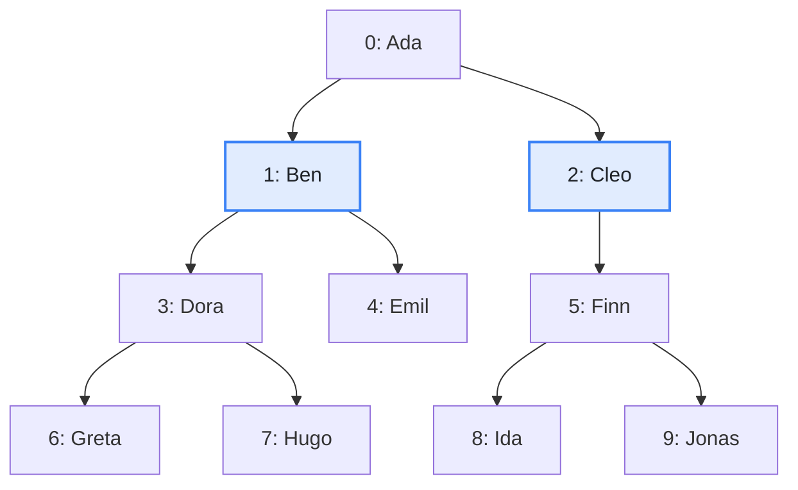
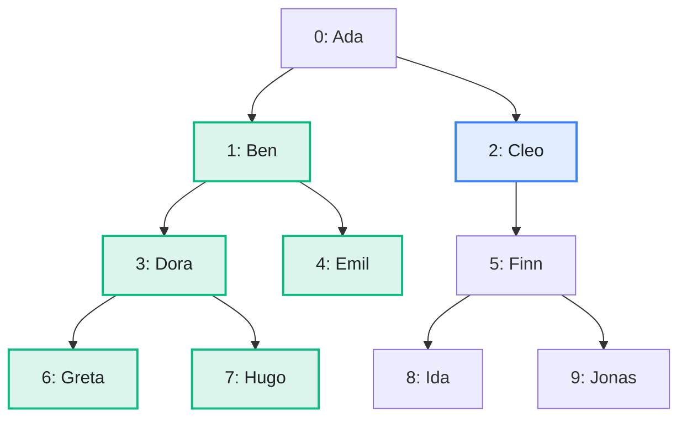

import Example from '../../../components/Example.astro';
import Api from '../../../components/Api.astro';
import Compare from '../../../components/Compare.astro';
import Gap from '../../../components/Gap.astro';
import InCode from '../../../components/InCode.astro';

:::note[In short]
- <Api ref="PreorderAncestry.of(Ancestry)" /> of <Api ref="Ancestry.of(Graph)" /> builds an index
  of a [forest](../../glossary/#tree-and-forest) whose edges point from
  [parent](../../glossary/#parent-and-child) to child. The index holds the
  [preorder](../../glossary/#subtree-and-preorder) of the forest.
- <Api ref="PreorderAncestry.subtreeOf(int)" /> returns the
  [subtree](../../glossary/#subtree-and-preorder) of a node: the node and all its
  [descendants](../../glossary/#ancestor-and-descendant).
- <Api ref="PreorderAncestry.subtreeSizeOf(int)" /> returns how many nodes the subtree has.
- <Api ref="PreorderAncestry.preorder()" /> lists the whole forest in preorder, in which each node
  is followed by the subtrees of its children.
- <Api ref="PreorderAncestry.preorderIndexOf(int)" /> returns the position of a node in the
  preorder.
:::

## Problem

You want a node of a hierarchy and everything below it, as a list. The node with all its descendants
is called its subtree. Often you want an order in which every node comes before its descendants,
such as the order of the source code or of a listing. You need this to list:

- all statements inside a block of code;
- all files in a folder and its subfolders;
- all employees of a department;
- all descendants of a person.

## Example

The example graph `family` models a family tree that records one
[parent](../../glossary/#parent-and-child) per person. It has an edge from each parent to each
child. Who are `Ben` and his descendants? In which order does the preorder list the whole family? At
which position does it list `Cleo`?

<Compare
  before="The family tree and the people asked about"
  after="The subtree of Ben"
  legend={{ inputNode: 'Person asked about', outputNode: 'Subtree of Ben' }}
>

</Compare>

In the picture after, the subtree of `Ben` is green: `Ben` and his descendants. `Cleo` is the other
person the example asks about, for her position in the preorder.

## Solution

<Example java="guide/ReadingAncestry.java#subtreeOf" />

The preorder lists the [roots](../../glossary/#root-node) in ascending order of their
[node IDs](../../glossary/#node-id), and the children of each node in the same way. Here, it lists
`Ada`, then the subtree of `Ben`, then the subtree of `Cleo`. So each subtree takes a range of
consecutive positions. The subtree of `Ben` takes the positions 1 to 5, and
<Api ref="PreorderAncestry.subtreeOf(int)" /> returns this range of the preorder without copying
it. `Cleo` comes at position 6, after `Ada` and the subtree of `Ben`.

## Good to know

- **Numbered in preorder already?** If the node IDs were assigned in preorder, the subtree of a node
  is a range of node IDs. An example is a syntax tree numbered in source order, in which each node
  comes before the nodes it contains. The range starts at the ID of the node itself, and
  <Api ref="PreorderAncestry.subtreeSizeOf(int)" /> returns how many IDs it holds.
- **Data by position.** In an array of data indexed by the position that
  <Api ref="PreorderAncestry.preorderIndexOf(int)" /> returns, every subtree is a range of
  consecutive entries. A sum over a subtree, for example, then comes from the prefix sums of the
  array.
- **Dominance.** <Api ref="PreorderAncestry.of(Ancestry)" /> of
  <Api ref="Ancestry.of(Dominators)" /> does the same for the
  [dominator tree](../../glossary/#dominator) of a
  [control-flow graph](../../glossary/#control-flow-graph). There, the subtree of a block holds
  every block it dominates. See
  [Build the dominator tree and ask it questions](../../dominance/dominator-tree/).
- **Not a forest?** In a [DAG](../../glossary/#dag) (directed acyclic graph), the descendants of a
  node are the nodes it [reaches](../../glossary/#reach). A family with both parents recorded is
  such a graph. See [Find everything a node reaches](../../reachability/reachable-from/).
