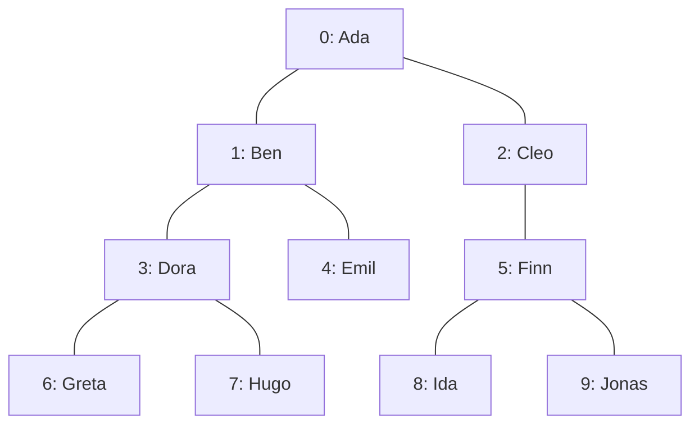
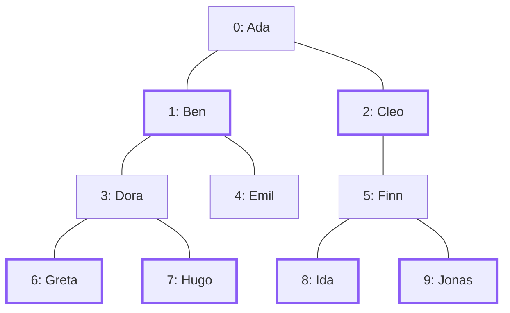
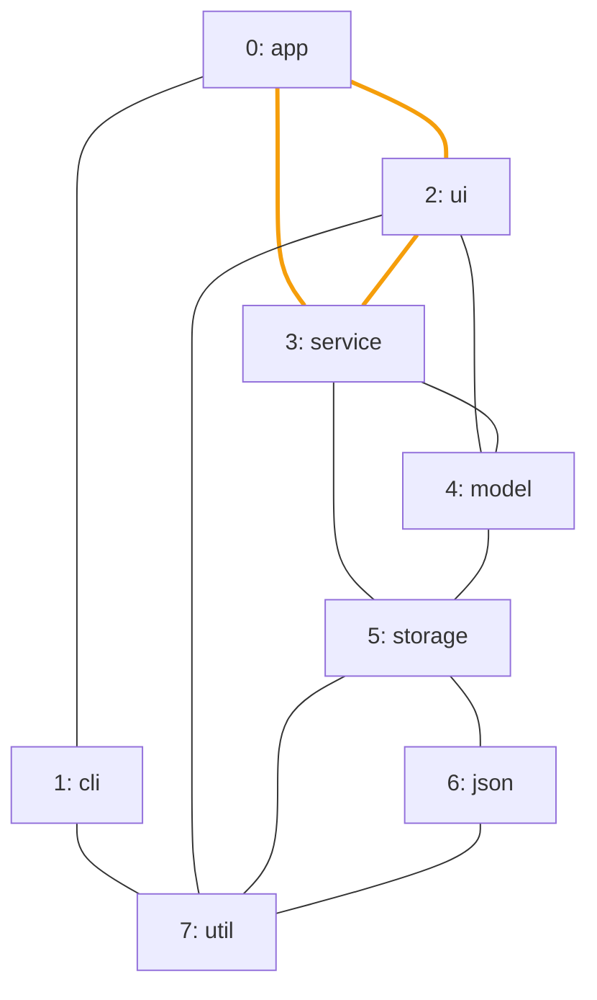

import Example from '../../../components/Example.astro';
import Api from '../../../components/Api.astro';
import Compare from '../../../components/Compare.astro';
import Figure from '../../../components/Figure.astro';
import Gap from '../../../components/Gap.astro';
import InCode from '../../../components/InCode.astro';

:::note[In short]
- <Api ref="Graphs.isBipartite(Graph)" /> reads a graph as
  [undirected](../../glossary/#undirected-reading) and tells whether its nodes split into two sets
  so that every edge runs from one set to the other.
:::

## Problem

You want to know whether the nodes of a graph can be divided into two sets so that every edge runs
between the sets. The direction of the edges does not matter for this, so the graph is read as
undirected. A graph with such a division is called [bipartite](../../glossary/#bipartite). Some
algorithms expect such a graph. You need this for:

- two kinds of nodes with edges only between the kinds, such as users and the resources they use, or
  students and the courses they take;
- a schedule with two rooms, in which two events that conflict must not share a room;
- a model that should have two kinds of nodes: if its graph is not bipartite, an edge joins two
  nodes of the same kind, which is a sign of an error in the model.

## Example

The example checks two graphs, both read as undirected. The first graph `family` models a family
tree that records one [parent](../../glossary/#parent-and-child) per person. It has an edge from
each parent to each child. Can the people be split into two sets so that every edge runs between the
sets?

<Compare before="The family tree" after="Two sets" legend={{ contextNode: 'First of the two sets' }}>

</Compare>

Graphity answers only yes or no. The picture after shows two sets that make the answer yes. The
first set holds the children and the great-grandchildren of `Ada`. The second set holds the others.

The second graph `dependencies` models the packages of a small program. It has an edge from each
package to each package it uses. Can the packages be split in the same way? Every edge here lies on
a [cycle](../../glossary/#cycle). The orange edges form one of these cycles: the triangle of `app`,
`ui` and `service`, which is a cycle of three edges.

<Figure legend={{ cycleEdge: 'Edge of the triangle' }}>

</Figure>

## Solution

<Example java="guide/CheckingUndirectedShapes.java#isBipartite" />

The family tree is bipartite. Every edge joins a parent and a child, whose
[depths](../../glossary/#depth) differ by one, so the people at an even depth and those at an odd
depth are the two sets. The packages are not bipartite. Of the three packages of a triangle, two
would have to be in the same set, and the edge between them would not run from one set to the
other.

## Good to know

- **Odd cycles.** A graph is bipartite exactly if no cycle of its undirected reading has an odd
  number of edges. So every [tree and every forest](../../glossary/#tree-and-forest) is bipartite.
- **[Self-loops](../../glossary/#self-loop)** make a graph not bipartite: a node cannot be in both
  sets. The checks for trees and forests of the undirected reading ignore self-loops, so a graph
  they accept is still not bipartite if it has one. See
  [Find out whether an undirected graph is a tree or a forest](../undirected-trees/).
- **The empty graph** is bipartite.

<Gap>
Return the two sets, or a cycle of odd length that proves there are none: Graphity answers only yes
or no.
</Gap>
