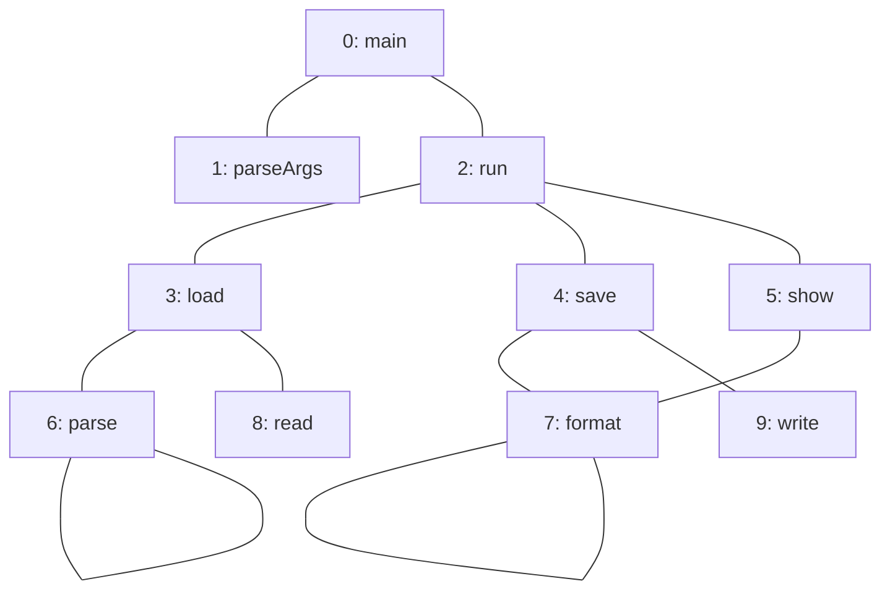
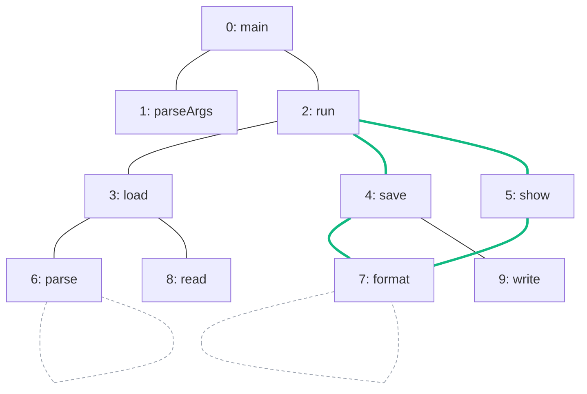

import Example from '../../../components/Example.astro';
import Api from '../../../components/Api.astro';
import Compare from '../../../components/Compare.astro';
import Gap from '../../../components/Gap.astro';
import InCode from '../../../components/InCode.astro';

:::note[In short]
- <Api ref="Components.biconnectivityOf(BiAdjacentGraph)" /> reads a graph as
  [undirected](../../glossary/#undirected-reading) and finds its [biconnected
  components](../../glossary/#biconnected-component), also called blocks: groups of edges in which
  any two edges lie on a common [cycle](../../glossary/#cycle).
- <Api ref="Biconnectivity.blocks()" /> returns them.
- The blocks divide the edges, not the nodes: <Api ref="EdgePartition.edgesOf(int)" /> returns the
  edges of a block.
:::

## Problem

You want to find the areas of a graph that stay connected when any one of their nodes is removed,
whatever the direction of the edges. Such an area, as large as it can be, is called a biconnected
component or block. The edges of a block form a group in which any two edges lie on a common cycle.
The one exception is a single edge that lies on no cycle: it is a block of its own, called a
[bridge](../../glossary/#bridge-and-articulation-point). Removing it splits the graph. A node that
belongs to more than one block is called an articulation point. Removing it splits the graph as
well. You need this to find:

- the groups of routers in a network that stay connected when any one router fails;
- the modules of a system that stay connected when any one of them fails.

## Example

The example graph `calls` models the calls between the methods of a small program. It has an edge
from each method to each method it calls. The array `names` holds the names of the methods. Here,
the graph is read as undirected. Which calls lie on a common cycle and form a block together? Which
calls are blocks of their own?

<Compare
  before="The calls, read as undirected"
  after="The large block, and the self-loops in no block"
  legend={{ omittedEdge: 'Self-loop in no block', outputEdge: 'Call in the large block' }}
>

</Compare>

In the picture after, the four green calls form the large block. Each of the other six calls
between two different methods is a block of its own, and the two dashed
[self-loops](../../glossary/#self-loop) are in no block.

## Solution

The blocks come from the same analysis as the bridges and articulation points. It follows the edges
in both directions, so it takes a <Api ref="BiAdjacentGraph" />, which
<Api ref="BiAdjacentGraph.of(Graph)" /> builds from the graph:

<Example java="guide/FindingBridges.java#blocks" />

The calls form seven blocks. Six of them are single calls, which are the bridges. The seventh holds
the four calls on the cycle through `run`, `save`, `format` and `show`: any two of them lie on a
common cycle, and these four methods stay connected if any one of them is removed.

## Good to know

- **Edges, not nodes.** An articulation point belongs to every block it touches: `run` belongs to
  three. So the blocks are a [partition](../../glossary/#partition-and-group) of the edges, and the
  result is an <Api ref="EdgePartition" />. <Api ref="IndexPartition.groupCount()" /> returns the
  number of blocks, and <Api ref="IndexPartition.sizeOf(int)" /> the number of edges in a block.
  <Api ref="EdgePartition.edgeCount()" /> returns the number of edges of the graph, whether in a
  block or not.
- **Self-loops** are in no block: for a self-loop, <Api ref="IndexMapping.get(int)" /> returns
  <InCode java="-1" rust="None" ts="-1" csharp="-1" /> instead of a block. Every other edge is in
  exactly one block.
- **Edges in both directions.** The edges `a -> b` and `b -> a` count as one undirected edge, and
  both are in the same block, so a bridge stored in both directions is a block of two edges.
- **Only the bridges and articulation points?** They come from the same call. See
  [Find the edges and nodes whose removal splits a graph](../bridges/).

<Gap>
Build the block-cut tree. It has a node for each block and each articulation point, and an edge
between a block and each articulation point that belongs to it. For a graph that is not connected,
it is a [forest](../../glossary/#tree-and-forest). Graphity returns the blocks and the articulation
points, but not this tree.
</Gap>
