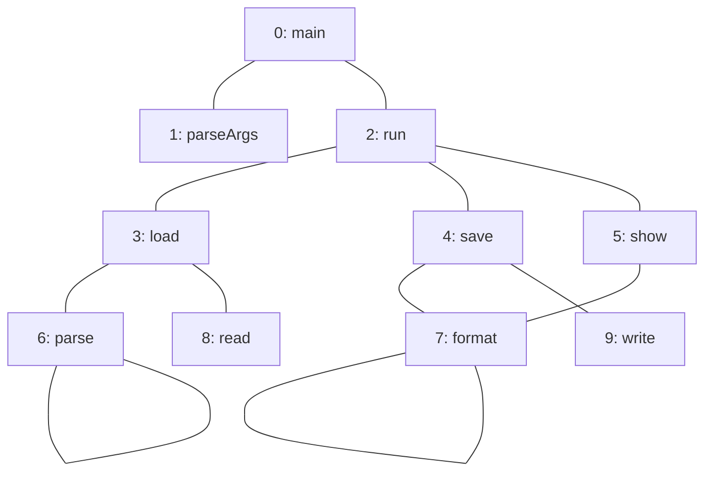
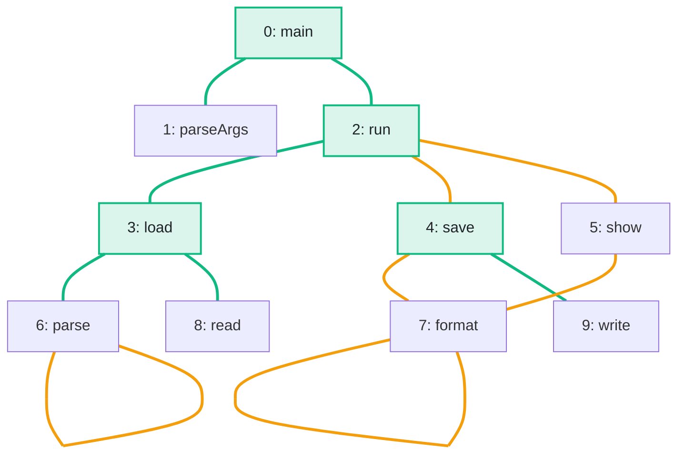

import Example from '../../../components/Example.astro';
import Api from '../../../components/Api.astro';
import Compare from '../../../components/Compare.astro';
import Gap from '../../../components/Gap.astro';
import InCode from '../../../components/InCode.astro';

:::note[In short]
- <Api ref="Components.biconnectivityOf(BiAdjacentGraph)" /> reads a graph as
  [undirected](../../glossary/#undirected-reading) and finds its
  [bridges and articulation points](../../glossary/#bridge-and-articulation-point).
- <Api ref="Biconnectivity.bridges()" /> returns the edges whose removal splits a
  [component](../../glossary/#weakly-connected-component).
- <Api ref="Biconnectivity.articulationPoints()" /> returns the nodes whose removal splits a
  component.
:::

## Problem

You want to know which single edge or single node a graph cannot lose, because some nodes would no
longer be connected to the others. The direction of the edges does not matter for this, so the graph
is read as undirected. An edge whose removal splits a component in two is called a bridge. A node
whose removal splits a component is called an articulation point. You need this to find:

- a cable or a router whose failure cuts a network in two;
- a single call that is all that connects two areas of a program;
- a module through which every [path](../../glossary/#path) between two halves of a system passes.

## Example

The example graph `calls` models the calls between the methods of a small program. It has an edge
from each method to each method it calls. Here, the graph is read as undirected. Without which
single call, and without which method, are some methods no longer connected to the others?

<Compare
  before="The calls, read as undirected"
  after="Bridges and articulation points"
  legend={{ cycleEdge: 'Call on a cycle', outputNode: 'Articulation point', outputEdge: 'Bridge' }}
>

</Compare>

In the picture after, the bridges and the articulation points are green. The orange edges lie on a
[cycle](../../glossary/#cycle), and none of them is a bridge. Four of them are the calls through
`run`, `save`, `format` and `show`. The other two are the [self-loops](../../glossary/#self-loop) of
`parse` and `format`, and each of these is a cycle of its own.

## Solution

The analysis follows the edges in both directions, so it takes a <Api ref="BiAdjacentGraph" />,
which <Api ref="BiAdjacentGraph.of(Graph)" /> builds from the graph:

<Example java="guide/FindingBridges.java#biconnectivity" />

Six calls are bridges: every call between two different methods except the four on the cycle through
`run`, `save`, `format` and `show`. Four methods are articulation points:

- Without `main`, `parseArgs` is connected to no other method.
- Without `run`, `main` and `parseArgs` are no longer connected to the rest.
- Without `load`, neither `parse` nor `read` is connected to another method.
- Without `save`, `write` is connected to no other method.

## Good to know

- **Bridges and cycles.** An edge is a bridge exactly if it lies on no cycle of the undirected
  reading. `run -> save` is no bridge: without it, `run` and `save` are still connected through
  `show` and `format`.
- **Edges in both directions.** The edges `a -> b` and `b -> a` count as one undirected edge, so a
  graph that stores both directions still has bridges. Of a bridge stored in both directions,
  <Api ref="Biconnectivity.bridges()" /> lists only the edge from the lower to the higher
  [node ID](../../glossary/#node-id). Self-loops are never bridges.
- **The [biconnected components](../../glossary/#biconnected-component)** come from the same
  analysis. See [Divide the edges of a graph into biconnected components](../blocks/).
- **Following the direction**, the same question is about
  [strongly connected components](../../glossary/#strongly-connected-component). See
  [Find the edges and nodes whose removal splits a strongly connected component](../../sccs/strong-bridges/).
