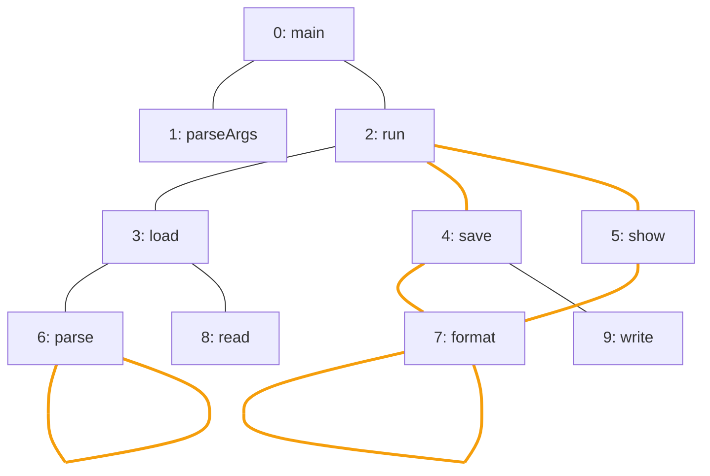

import ChapterProblems from '../../../components/ChapterProblems.astro';
import Figure from '../../../components/Figure.astro';

Some questions ignore the direction of the edges, for example: whether a [path](../glossary/#path)
connects two areas of a program, which single edge or node splits a network when it is removed, or
whether a structure is a [tree](../glossary/#tree-and-forest). For them, an edge `a -> b` simply
connects `a` and `b`.

## Problems in this chapter

<ChapterProblems />

The examples of this chapter use the calls between the methods of a small program, the dependencies
between its packages, and a family tree that records one [parent](../glossary/#parent-and-child) per
person.

## Reading a graph as undirected

A graph in Graphity is always directed. The methods of this chapter read it as
[undirected](../glossary/#undirected-reading): an edge connects its
[source and its target](../glossary/#source-and-target), whether or not the reverse edge exists. The
edges `a -> b` and `b -> a` count as one undirected edge. So an undirected graph can be stored with
one edge per pair of [neighbors](../glossary/#neighbor) or with both directions, and these methods
read it the same way. The pictures of this chapter draw the edges without arrows.

This picture shows the calls between the methods of a small program. The orange edges lie on a
[cycle](../glossary/#cycle) of the undirected reading. Such a cycle uses no edge twice, so going
along an edge and back is no cycle.

<Figure legend={{ cycleEdge: 'Call on a cycle' }}>

</Figure>

Read like this, `parseArgs` and `run` are connected through `main`, which calls both. And `run`
calls `save` and `show`, which both call `format`. Read as undirected, these four calls form a
cycle, although no call leads back to `run`. `parse` and `format` call themselves, and each of these
[self-loops](../glossary/#self-loop) is a cycle of its own.

## Components

In the undirected reading, a group of nodes that are connected by paths, as large as it can be, is
called a [weakly connected component](../glossary/#weakly-connected-component) or a component for
short. Nodes in different components are not connected at all. The calls above are one component.
Without the calls that `main` and `run` make, five components remain.

## Bridges, articulation points and blocks

An edge whose removal increases the number of components is called a
[bridge](../glossary/#bridge-and-articulation-point). A node whose removal does the same is called
an articulation point. An edge is a bridge exactly if it lies on no cycle. In the calls above, every
call between two different methods is a bridge, except the four orange ones. `run` is an
articulation point, since without it `main` and `parseArgs` are no longer connected to the rest.

The [biconnected components](../glossary/#biconnected-component) of a graph are groups of edges,
also called blocks. Any two edges of a block lie on a common cycle, and each block is as large as it
can be. Each bridge is a block of its own, and each articulation point belongs to more than one
block. The four orange calls between different methods are one block.

## Bipartite graphs, trees and forests

A graph is [bipartite](../glossary/#bipartite) if its nodes split into two sets so that every edge
runs from one set to the other. That is the case exactly if no cycle has an odd number of edges.
Read as undirected, a forest is a graph without cycles, and a tree is a forest that is connected.
The calls above are no forest, because of the cycle through `run`, `save`, `format` and `show`. The
family tree is a tree in either reading, and every tree is bipartite. See the chapter
[Trees and hierarchies](../trees/) for trees whose edges point away from their
[root](../glossary/#root-node).
