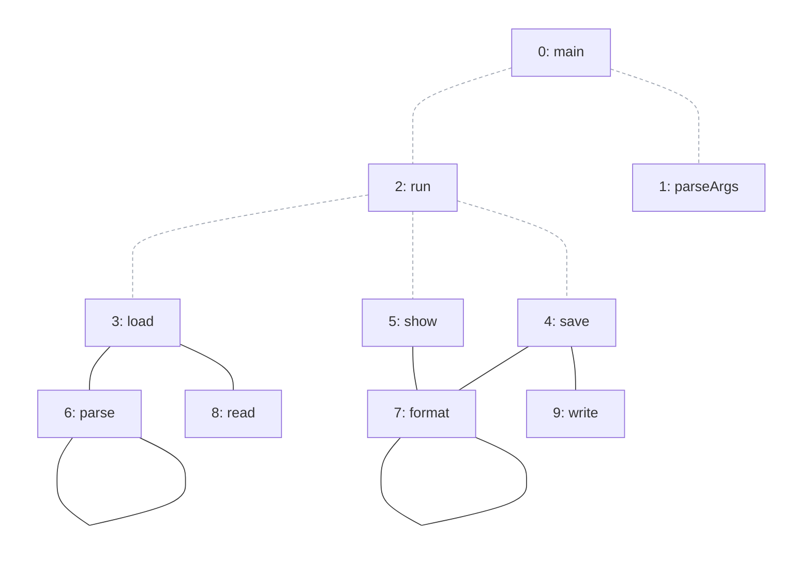
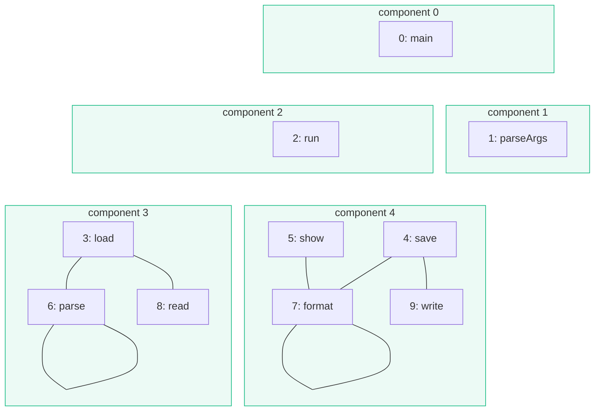

import Example from '../../../components/Example.astro';
import Api from '../../../components/Api.astro';
import Compare from '../../../components/Compare.astro';
import Gap from '../../../components/Gap.astro';
import InCode from '../../../components/InCode.astro';

:::note[In short]
- <Api ref="Components.wccsOf(Graph)" /> divides the nodes into
  [weakly connected components](../../glossary/#weakly-connected-component): the groups of nodes
  that [paths](../../glossary/#path) connect when the direction of the edges does not matter.
- <Api ref="Graphs.isWeaklyConnected(Graph)" /> tells whether there is at most one.
:::

## Problem

You want to know which nodes of a graph are connected at all, whatever the direction of the edges,
or just whether everything is connected. Reading the edges without their direction is called the
[undirected reading](../../glossary/#undirected-reading). In this reading, a group of nodes that are
connected by paths, as large as it can be, is called a component. No path connects nodes in
different components. You need this to find:

- modules of a codebase that no reference connects, and that could be split off;
- sub-problems that do not depend on each other, and can be solved separately;
- networks with no link between them.

## Example

The example graph `calls` models the calls between the methods of a small program. It has an edge
from each method to each method it calls. The array `names` holds the names of the methods. `main`
and `run` call into every area of the program. The picture before shows the calls they make as
dashed edges. Without these calls, which methods are still connected by calls?

<Compare
  before="The calls kept, and those of main and run left out"
  after="The components that remain"
  legend={{ omittedEdge: 'Call left out', outputGroup: 'Component' }}
>

</Compare>

The picture after shows the five components that remain, each in a frame.

## Solution

Build the graph without the calls of `main` and `run`, then find its components:

<Example java="guide/FindingParts.java#rest" />

<Example java="guide/FindingParts.java#wccsOf" />

<Api ref="Components.wccsOf(Graph)" /> returns a <Api ref="NodePartition" /> with five groups. One
group holds `load`, `parse` and `read`. One group holds `save`, `show`, `format` and `write`. Each
of `main`, `parseArgs` and `run` is a group of its own. All the calls together are one component.
The calls without those of `main` and `run` are not.

## Good to know

- **A [partition](../../glossary/#partition-and-group).** The result is a partition of the nodes,
  like the [strongly connected components](../../glossary/#strongly-connected-component). Every
  node is in exactly one component. <Api ref="IndexPartition.groupCount()" /> counts the components,
  and <Api ref="NodePartition.nodesOf(int)" /> lists the nodes of each in ascending order. The group
  IDs are in the order of the smallest nodes of the components. Component 0 holds node 0, component
  1 holds the smallest node that component 0 does not hold, and so on. Here each group ID happens to
  equal the smallest node of its component. In general it does not.
- **Weakly or not?** For a directed graph, these components are called weakly connected. The
  strongly connected ones follow the direction of the edges. See
  [Find the groups of nodes that reach each other](../../sccs/find-mutual-dependencies/). For a
  graph that stands for an undirected one, <Api ref="Components.ccsOf(Graph)" /> returns the same
  result under the name of connected components. The two names let the code say which reading it
  means.
- **Connected or not.** <Api ref="Graphs.isWeaklyConnected(Graph)" /> builds no partition and stops
  as soon as all nodes are connected. The empty graph and a graph of a single node are weakly
  connected.
- **Leaving out nodes.** To leave out nodes instead of edges, take the
  [subgraph](../../glossary/#subgraph) of the nodes you keep. See
  [Take the subgraph of some nodes](../../transforming/subgraph/).
