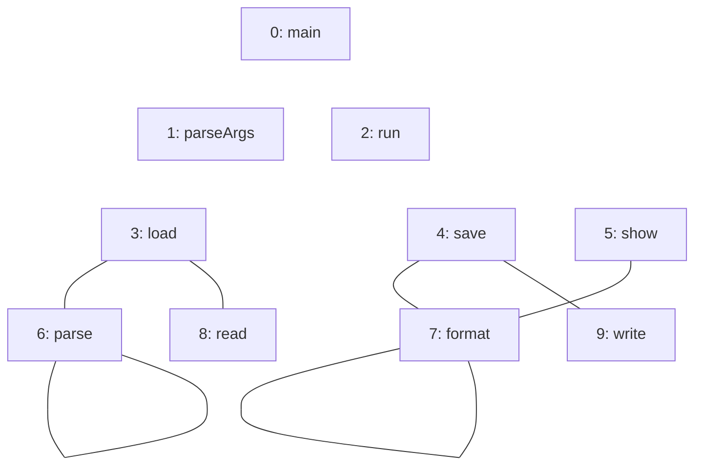
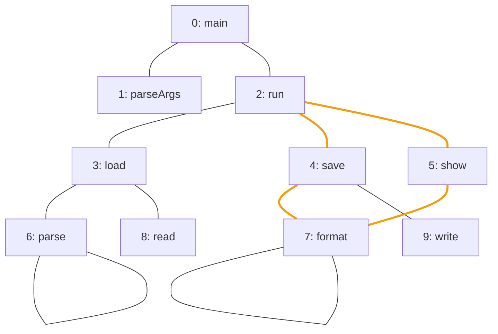

import Example from '../../../components/Example.astro';
import Api from '../../../components/Api.astro';
import Compare from '../../../components/Compare.astro';
import Gap from '../../../components/Gap.astro';
import InCode from '../../../components/InCode.astro';

:::note[In short]
- <Api ref="Graphs.isUndirectedForest(Graph)" /> tells whether a graph read as
  [undirected](../../glossary/#undirected-reading) has no [cycles](../../glossary/#cycle) other than
  [self-loops](../../glossary/#self-loop), which it ignores: a
  [forest](../../glossary/#tree-and-forest).
- <Api ref="Graphs.isUndirectedTree(Graph)" /> tells whether it is also connected: a tree.
:::

## Problem

You want to know whether a graph has the shape of a tree, whatever the direction of its edges. Read
as undirected, a graph without cycles is a forest. A forest that is connected is a tree. You need
this for:

- a network that should have no redundant connections;
- a hierarchy that someone stored as plain links, without a direction from
  [parent](../../glossary/#parent-and-child) to child;
- the result of an algorithm that should be a tree, such as a set of connections that connects all
  nodes of a network with as few connections as possible.

## Example

The example checks three graphs, each read as undirected:

- The first graph `calls` models the calls between the methods of a small program. It has an edge
  from each method to each method it calls.
- The second graph `rest` models the same calls without those made by `main` and `run`.
  See [Find the components of a graph read as undirected](../parts/) for another use of this graph.
- The third graph `family` models a family tree that records one parent per person. It has an edge
  from each parent to each child.

Which of the three are forests, and which are trees?

<Compare
  before="The calls without those of main and run"
  after="All the calls"
  legend={{ cycleEdge: 'Call on the cycle' }}
>

</Compare>

The picture after shows all the calls, and its orange edges lie on a cycle through `run`, `save`,
`format` and `show`. The family tree has no picture here.

## Solution

<Example java="guide/CheckingUndirectedShapes.java#undirectedTree" />

Without the calls of `main` and `run`, each of the five
[components](../../glossary/#weakly-connected-component) is a tree once the self-loops of `parse`
and `format` are ignored. Together they are a forest. They are not a tree, since they are not
connected. With all the calls, `run`, `save`, `format` and `show` lie on a cycle, so the calls are
not even a forest. The family tree is a tree in either reading.

## Good to know

- **Self-loops are ignored** by these checks: `parse` and `format` call themselves, and their
  components are still trees. To count a self-loop as a cycle, also check
  <Api ref="Graph.containsSelfLoop(int)" /> for every node. A self-loop does make a graph not
  [bipartite](../../glossary/#bipartite). See
  [Find out whether a graph is bipartite](../bipartite/).
- **Edges in both directions** count as one undirected edge: a tree may store each of its edges as
  `a -> b` and as `b -> a`.
- **Edges that point away from the [root](../../glossary/#root-node).** Whether a graph is a tree in
  which every edge points from a parent to a child is a different question. See
  [Find out whether a graph is a tree, a forest or a path](../../trees/shapes/).
- **The empty graph** is a tree and a forest.

<Gap>
Find a spanning tree of a graph read as undirected. That is a tree of its edges that connects all
its nodes, or one such tree per component. When the edges have costs, find one of least total cost.
Graphity checks whether a graph is a tree, but it has no call that finds one in a graph. Weights on
edges are not supported yet.
</Gap>
